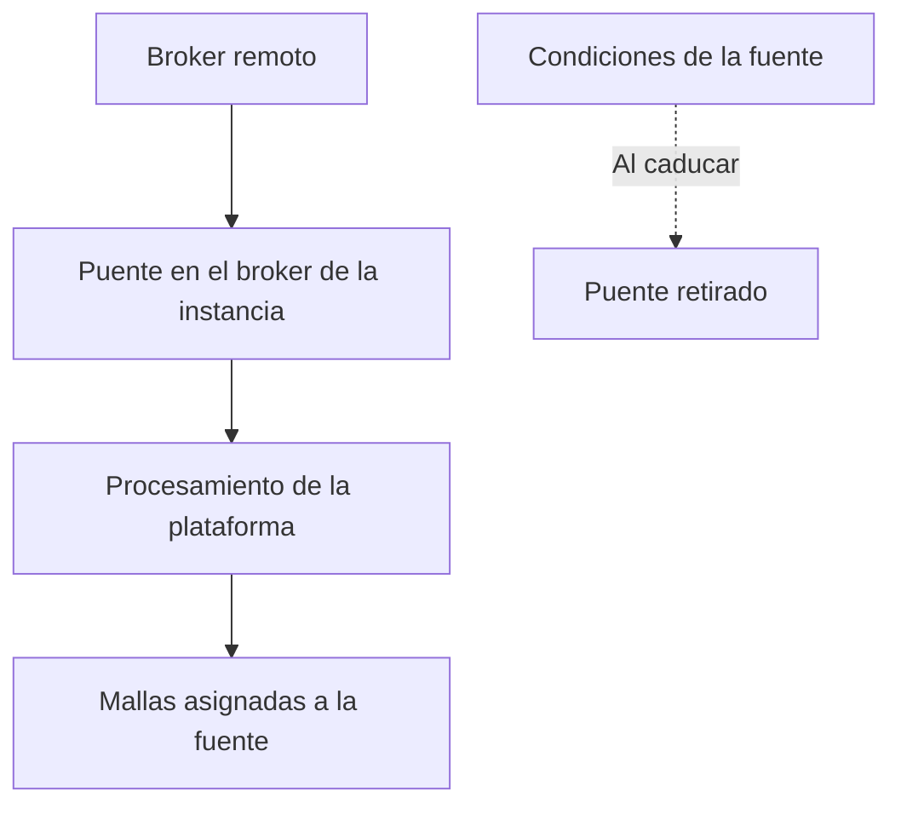

Una fuente es un broker MQTT remoto y un filtro de topic. El broker de la instancia se suscribe a ese filtro y copia en la plataforma el tráfico que coincide. Solo los operadores y los superusuarios gestionan fuentes. Un operador ve las fuentes que ha creado. Un superusuario las ve todas. Cualquier otra persona recibe 403. El menú **Datos** no muestra la página, y abrir `/console/sources` redirige a la página de mallas.

No se guarda nada hasta que el puente está en marcha. Cuando caducan las condiciones de la fuente, se retira el puente.

<Callout type="warn" title="Un puente fallido no guarda nada">
Si no se puede crear el puente, la API devuelve 502 y la fuente no se guarda. Al editar, un 502 significa que la fuente almacenada no cambia y se restaura el puente anterior. Al eliminar, un 502 significa que la fuente se conserva.
</Callout>

Un miembro pide el rol de operador en la página de perfil. Véase [Cuentas](/accounts).

## Campos de registro

| Campo | Regla |
| --- | --- |
| Etiqueta | Nombre opcional que se muestra en la lista |
| Servidor | `host:port`. No puede ser el broker de esta instancia. |
| Topic | El filtro de topic que se importa. Se rechaza un filtro que empiece por `$`, incluidos `$share` y `$SYS`. También se rechaza un filtro que pueda coincidir con los topics que esta instancia usa para fuentes y destinos. |
| TLS | Activado por defecto. El campo de la API es `ssl`. |
| Usuario y contraseña | La contraseña es de solo escritura y nunca se devuelve. Una contraseña exige un usuario. |
| QoS | 0 o 1. El valor por defecto es 1. |

Al crear una fuente se aceptan las condiciones de fuente vigentes (`GET /sources/terms`) y se envía `terms_version`. El operador es el responsable del tratamiento del tráfico importado. Sensical es el encargado del tratamiento. La aceptación es un acuerdo con el operador y se guarda con un hash del texto exacto. Se pide en cada creación, y no al editar. Las instancias que no exigen condiciones omiten este paso.

## Mallas en una fuente

Al crear o editar una malla, un operador elige **Broker por defecto** o una de sus fuentes. `source_id: null` es el broker por defecto. La lista muestra el nombre de la fuente en las mallas del usuario. Las mallas de otra persona no muestran el identificador de la fuente.

No se puede eliminar una fuente mientras tenga mallas asignadas. La API devuelve 409. El diálogo de eliminación enumera esas mallas, cada una con un enlace. Reasígnalas antes.

## Caducidad y renovación

Las condiciones de una fuente pueden caducar. Al caducar se establece `paused_at`, se retira el puente y las mallas de la fuente dejan de recibir datos hasta que quien la creó renueva las condiciones (`POST /sources/{id}/terms-acceptance`). Si el puente no puede rearrancar, la renovación devuelve 502 y las condiciones quedan como estaban. La lista muestra el estado. **Renovar** está disponible para quien creó la fuente cuando está en pausa, próxima a caducar o ligada a un texto que ha cambiado.

Al editar, puedes conservar la contraseña, sustituirla o borrarla con una cadena vacía. Un 502 al editar significa que el puente no se ha reconfigurado y que la fuente almacenada no cambia.

Si una fuente se mantiene por encima de la tasa de mensajes fijada para la instancia, se avisa por correo a los superusuarios activos. El operador que la creó solo recibe el aviso si tiene activadas las alertas de tasa de la fuente. El correo se envía una vez mientras la fuente sigue por encima de esa tasa.
