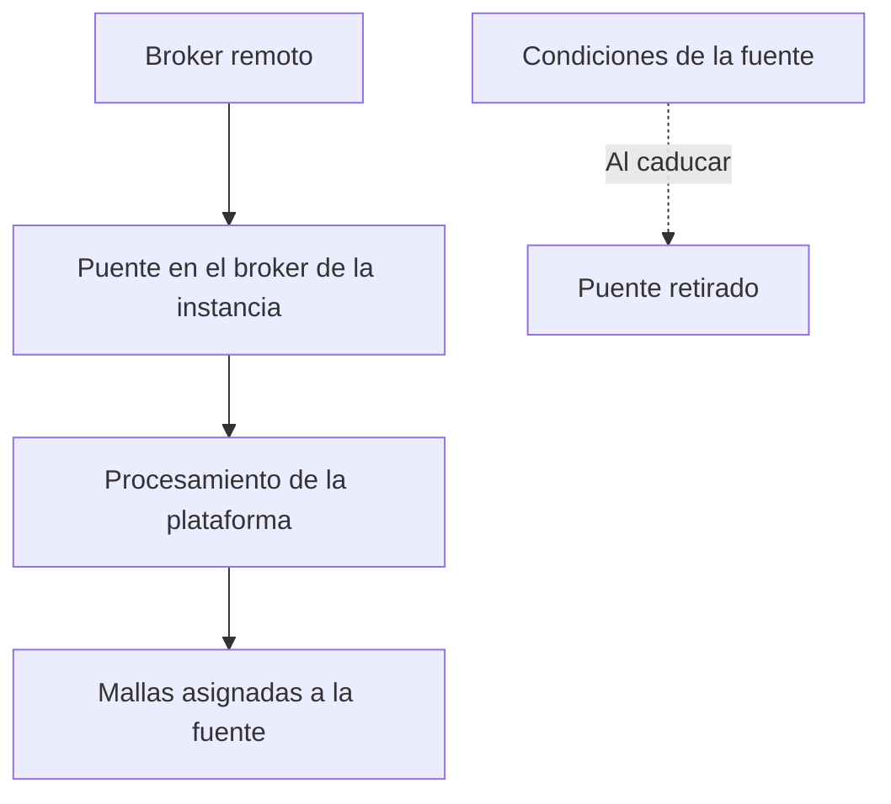

Una fuente es un broker MQTT remoto junto con un filtro de topic. El broker de la instancia se suscribe a ese filtro y copia en la plataforma el tráfico coincidente. Solo los operadores y los superusuarios gestionan fuentes: un operador puede consultar las fuentes que ha creado, y un superusuario puede consultarlas todas. El resto de usuarios recibe 403, el menú **Datos** no muestra la página y el acceso directo a `/console/sources` redirige a la página de mallas.

Una fuente importa datos desde un broker remoto. No se almacena ningún dato hasta que se establece el puente, y el puente se retira cuando caducan las condiciones de la fuente.

<Callout type="warn" title="Un puente fallido no almacena nada">
Si no es posible crear el puente, la API devuelve 502 y la fuente no se guarda. Al editar, una respuesta 502 indica que la fuente almacenada no ha cambiado.
</Callout>

Un miembro solicita el rol de operador desde la página de perfil. Véase [Cuentas](/docs/accounts).

## Campos de registro

| Campo | Regla |
| --- | --- |
| Etiqueta | Nombre opcional que se muestra en la lista |
| Servidor | `host:port` |
| Topic | El filtro de topic que se importa. Se rechazan `$share` y `$SYS`. |
| TLS | Activado por defecto |
| Usuario y contraseña | La contraseña es de solo escritura y nunca se devuelve. |
| QoS | 0 o 1. El valor por defecto es 1. |

Al crear una fuente se aceptan las condiciones de fuente vigentes (`GET /sources/terms`) y se envía `terms_version`. El operador actúa como responsable del tratamiento del tráfico importado, y Sensical como encargado del tratamiento. La aceptación constituye un acuerdo con el operador, se registra con un hash del texto exacto y se solicita en cada creación, pero no al editar. En las instancias que no exigen la aceptación de condiciones, este paso se omite.

## Mallas en una fuente

Al crear o editar una malla, un operador selecciona **Broker por defecto** o una de sus fuentes. `source_id: null` indica el broker por defecto. La lista muestra el nombre de la fuente en las mallas propias del usuario; las mallas de otros usuarios no muestran el identificador de la fuente.

No es posible eliminar una fuente mientras tenga mallas asignadas. El diálogo de eliminación enumera esas mallas con un enlace a cada una, y deben reasignarse previamente.

## Caducidad y renovación

Las condiciones de una fuente pueden caducar. Al caducar, se informa `paused_at`, se retira el puente y las mallas de la fuente dejan de recibir datos hasta que su creador renueva las condiciones (`POST /sources/{id}/terms-acceptance`). La lista muestra el estado, y la acción **Renovar** está disponible para el creador cuando la fuente está en pausa, próxima a caducar o vinculada a un texto que ha cambiado.

Al editar la contraseña, puede mantenerse el valor actual, sustituirse por uno nuevo o eliminarse enviando una cadena vacía. Una respuesta 502 al editar indica que el puente no se ha reconfigurado y que la fuente almacenada no ha cambiado.

Cuando una fuente se mantiene por encima de la tasa de mensajes permitida por la instancia, el operador que la creó puede recibir un aviso por correo.
