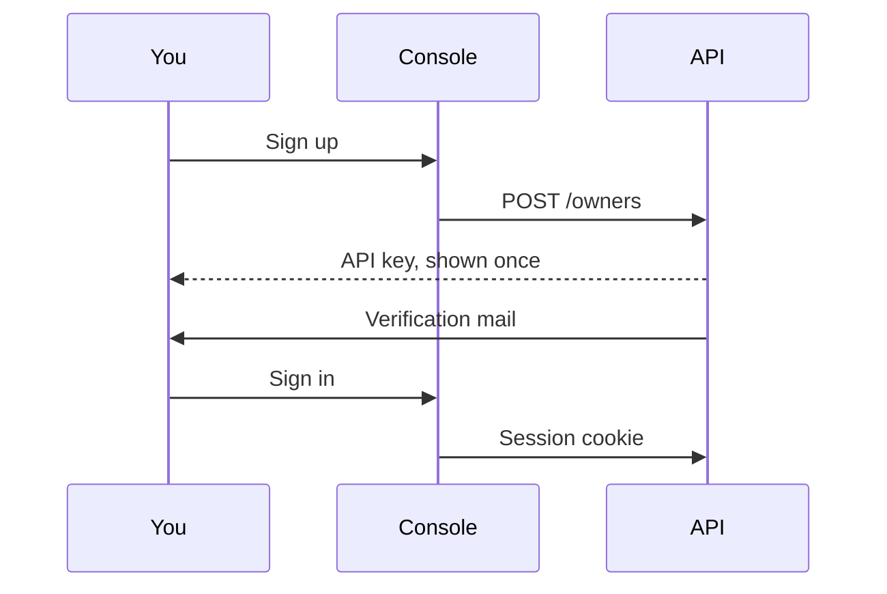

An account is an **owner**. The email is the username. `is_active` means the email has been verified.

Signing up and signing in are two different doors. The key is for scripts. The cookie is for the console. Neither one is stored in the browser as a secret you paste back later.

<Callout type="warn" title="The key is shown once">
Rotate it and the old key dies. The database keeps a SHA-256 hash, not the key. If you close the dialog, generate another one.
</Callout>

## Create an account

`POST /owners` creates the account and returns an API key once. The console sign-up is at `/signup`.

When the instance enforces terms (`REGISTRY__TERMS_ENFORCED`), sign-up also asks you to accept the terms of use and the privacy policy. Account terms do not expire. They are asked again only when the text changes. A lite instance that does not enforce terms skips this step; `GET /terms` answers 404 and the console hides the checkboxes.

Until the address is verified, the account cannot pass the usual checks. The verification link hits `GET /owners/verify-email`. You can ask for another message with `POST /owners/me/resend-verification`.

## Sign in

The console signs you in with a session cookie: `POST /owners/login` and `POST /owners/logout`. Unverified owners can still sign in so they can finish verification. Login is throttled per client IP and per email. Failed attempts expire; they are not a permanent counter.

The same session cookie is accepted by the readings API. Both API roles share a secret so a cookie issued by the registry still decodes there.

Scripts use `Authorization: Bearer` and the API key. Rotate it with `POST /owners/me/rotate-key`. The new key is shown once. The database stores only a SHA-256 hash.

Password reset is a token in the request body (`POST /owners/request-password-reset`, then `POST /owners/reset-password`). Change it while signed in with `POST /owners/me/change-password`.

## Roles

| Role | How you get it | Extra power |
| --- | --- | --- |
| Member | Sign-up | Own meshes, devices, and blueprints |
| Operator | A superuser approves your request | Sources, sinks, and the archive |
| Staff | Granted on the server | Read the catalog, no secrets, no writes |
| Superuser | `createsuperuser` | Every mesh, every key, the admin site at `/admin/` |

Ask for operator from **Profile**. One pending request per owner. A rejection lets you ask again. Superusers decide under **Management → Operator requests**. Approving sets `role` to `operator`.

## What you can see

A verified owner reads their meshes and any mesh marked public. A superuser reads everything. Writes never follow the public flag.

Staff read the catalog and do not see PSKs. Operators see only the sources and sinks they created, unless they are a superuser, who sees all of them.

## Alarm mail for this account

`alarm_email_cooldown_seconds` on `PUT /owners/me` overrides the server default for how long alarms on one device are held before a summary mail. Null means "use the server default". See [Quality and alarms](/docs/quality).

Two more switches are about infrastructure you created, not about sensor alarms:

- `status_alerts_enabled` — mail when a source or sink you created stays disconnected or unused.
- `source_rate_alerts_enabled` — mail when a source you created stays busier than the instance allows. Superusers are also told when a source is unusually busy.
