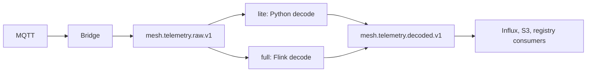
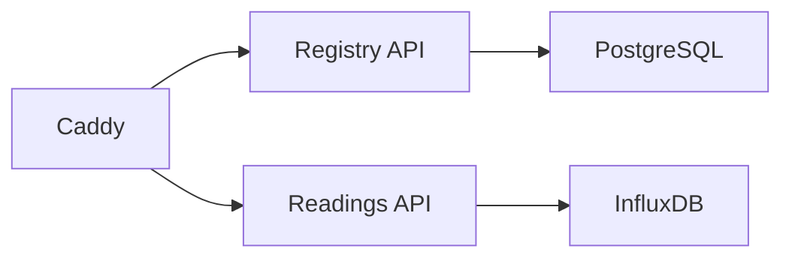

Everything is declared in Compose files under `compose/`, included from `docker-compose.yml`. Production binds only loopback, except Caddy on `80` and `443`. The dev overlay publishes admin UI ports and switches Django to `dev` settings. `env.example` turns that overlay on; a production `.env` deletes the `COMPOSE_FILE` line and sets `COMPOSE_PROFILES` instead.

Caddy is the only public door. Behind it, the raw topic splits by profile, and the two APIs never share a database role.



Caddy is a separate door. It does not decode packets. Registry answers from PostgreSQL. Readings answers from InfluxDB.



<Callout type="warn" title="Do not run both decoders">
`lite` and `full` compete for `mesh.telemetry.raw.v1`. The rest of the profiles (`quality`, `sinks`, `minio`, `monitor`) stack on top of one of them.
</Callout>

Both API secret keys must be set before the APIs start. `DJANGO_SETTINGS_MODULE` is `api_project.settings.dev` or `api_project.settings.prod`, never the `settings` package itself.

## Profiles

| Profile | Effect |
| --- | --- |
| `lite` | Python `decode_consumer` instead of Flink |
| `full` | Flink jobs, S3 writer, sinks, quality worker |
| `quality` | Batch worker on a lite stack |
| `sinks` | MQTT sinks on a lite stack |
| `minio` | Bundled MinIO for the archive |
| `monitor` | Server monitor, on its own domain through Caddy |
| `kafka-ui` | Topic browser |
| `bridge-pool` | Extra MQTT bridge replicas |

Do not run `lite` and `full` together. They compete for `mesh.telemetry.raw.v1`.

```bash
cp env.example .env
docker compose --profile lite up -d
docker compose --profile lite --profile quality up -d
docker compose --profile full --profile minio up -d
```

## Always on

Kafka, PostgreSQL, Redis, InfluxDB, the registry API, the readings API, the MQTT bridge, the Influx writer, and Caddy. Three registry consumers stay up with the APIs: device sightings, sensor discovery, and alarm email.

Caddy is the public entrance. `/readings/*` goes to `readings_api`. Everything else, including `/schema` and the API's Swagger `/docs`, goes to `registry_api`. This console guide is a different site.

The readings role uses a Postgres role that cannot select PSK columns.

## Decode

`lite` runs `decode_consumer`. `full` runs a Flink job named `mesh-decode-decrypt` instead, plus calibration, pattern detection, and absence detection. Decode reads compact `mesh.keys.v1` (PSK by gateway) and `mesh.node_rejections.v1`. A packet whose gateway is unknown, or whose node is rejected, is dropped. Allowed packets become JSON with `mesh_id`, `node_id`, `payload_kind`, and `payload`.

## Kafka topics

Compact topics hold the current config. The rest are a log.

| Topic | Policy | Who writes | Who reads |
| --- | --- | --- | --- |
| `mesh.telemetry.raw.v1` | log | MQTT bridge | decode |
| `mesh.telemetry.decoded.v1` | log | decode | Influx writer, S3 writer, calibration |
| `mesh.telemetry.calibrated.v1` | log | Flink calibration | pattern detection |
| `mesh.telemetry.alarms.v1` | log | detectors, quality worker | Influx writer, alarm mail |
| `mesh.devices.v1` | log | decode | device consumer |
| `mesh.sensor_discovery.v1` | log | decode | discovery consumer |
| `mesh.keys.v1` | compact | registry | decode |
| `mesh.node_rejections.v1` | compact | registry | decode |
| `mesh.quality_config.v1` | compact | registry | Flink detectors |
| `mesh.calibration.v1` | compact | registry | Flink calibration |

Names above are the defaults. Deleting topics are capped at 1 GB.

## Batch quality

`quality_worker` runs blueprints over a lookback (default 7 days) and completeness checks. `quality_worker_beat` schedules `scan_devices`, hourly by default. The worker authenticates as a superuser.

## Operations

Each API role has `/health`. The registry exposes `/metrics`. Admin UIs (Flink, Kafka UI, InfluxDB, MinIO) are reverse-proxied by Caddy and gated with credentials from `caddy/credentials/`. The dev overlay adds MailHog and an MQTT share-group suffix so a laptop does not steal production traffic. Backups of Postgres and InfluxDB are encrypted with age and kept for 7 days.
