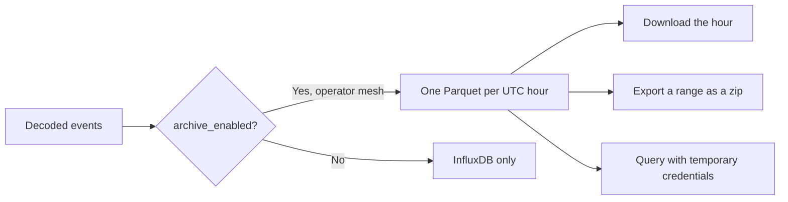

The archive is a long-term copy of decoded events, as Parquet in S3 or MinIO. It is off unless the device opts in. InfluxDB is still the store the console charts read.

Charts and the archive are not the same shelf. Turning the switch off stops new files. It does not throw away the ones already written.

<Callout type="info" title="Lite has no archive">
The list answers 404 and the console says so. `full` writes the files. Add `minio` to keep them on the bundled store, or point the writer at your own bucket.
</Callout>

The archive exists on a `full` deployment. Add the `minio` profile to keep it on the bundled MinIO, or point the writer at an external bucket and leave `minio` off. A lite instance has no archive: the list answers 404 and the console says so.

## Who can turn it on

`archive_enabled` is accepted only when the mesh owner is an operator, and only when this instance has an archive. The owner and superusers see the flag. Staff and public readers do not.

The console calls the switch **S3 storage**, on the device inventory, on the variant tables, and in the latest-value menu. **Archive** is the page, not the act of retiring a device. Turning the switch off stops new files and keeps the ones already written. Who switched it, and when, is stored on the device and, as history, in an append-only instruction row (the same ledger MQTT sinks use).

## The files

One object per mesh and UTC hour:

`{prefix}/mesh_id={uuid}/dt={YYYY-MM-DD}/hour={HH}/data.parquet`

`/console/archive` lists your meshes (a superuser also sees meshes that archive something they do not own) with device count, file count, size, and the latest hour. Open a mesh to see which devices are on, then the files: one row per UTC day, newest first, expanding to one download per hour.

Each hour is a redirect to the object. A whole day, or a longer range, is an export job with `format: parquet`: a zip with one folder per day and `YYYY-MM-DD/YYYY-MM-DD_HH.parquet` inside. The same limits as CSV apply (366 days, one job at a time, 24-hour link). See [Readings](/docs/readings).

## Query it yourself

**Command line** on the archive page can issue temporary credentials (shown once, not revoked early) and fill in either:

- a DuckDB `COPY` into a single Parquet file, or
- `aws s3 sync` of the hour folders as they are

Without STS, credential issue answers 404 and the page offers the per-file downloads instead. The DuckDB snippet uses path-style addressing and sets `USE_SSL` from the endpoint.
