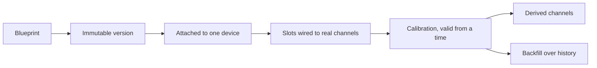

A blueprint is a recipe: an ordered list of named algorithms from `GET /algorithms`. The owner edits it under **Automation → Blueprints** (`/console/blueprints`). You see your own recipes and the public ones.

The recipe and the device stay apart on purpose. Editing steps does not silently change a device that is already running.

<Callout type="info" title="Calibration belongs to the device">
The recipe names the algorithm. The device stores the numbers, with `valid_from`, so reprocessing old data uses the calibration that was in force then.
</Callout>

## A version is immutable

Changing the name, the description, or whether the blueprint is public edits the blueprint in place. Changing steps creates a **new version**, copied from the latest. Devices attach to a version, not to "whatever the recipe says today", so a running device does not change formula under it.

Each step has:

- a key and an order, unique inside the version
- `function_name`, which must exist in the algorithm catalog
- `inputs`: each algorithm input is `slot:<name>` or `step:<key>.<output>`
- `params` for configuration. Parameters marked as calibration are not set here.
- `outputs`: each algorithm output becomes a derived field name

Renaming a slot or a step rewrites the references that point at it. The console checks the same rules the API checks before you send the form.

## Attach it to a device

On the device page, a postprocessing binds one blueprint version to that device:

- each input slot is wired to a real channel on this device
- `output_prefix` is prepended to every derived field, so the same blueprint can run twice
- `tolerance_seconds` is how far apart samples may be and still count as the same instant. Null uses half the device's reading interval
- `is_enabled` starts and stops it

Derived channels show up as measurements with `produced_by` pointing at that postprocessing. Their catalog type is removed when the last channel that used it disappears, so a stale unit cannot block a later attach.

## Calibration

Calibration belongs to the device, not to the recipe. `StepCalibration` is append-only: a step key, the algorithm name, the params, and `valid_from`. Reprocessing old data uses the calibration that was in force at that time. A calibration applies only while the step still runs the same algorithm.

Stream calibration on the full profile reads compact `mesh.calibration.v1` and writes `mesh.telemetry.calibrated.v1`. A bad function is logged and the raw value passes through.

## Backfill

`POST` a postprocessing backfill to rerun the recipe over a stored range. The quality worker claims the job. `include_dependants` also reruns postprocessings that read this one's outputs, in order. Status moves through `pending`, `running`, `done`, and `failed`. The row records how many points were published.

The batch executor loads the required Influx channels over the lookback, aligns them to the reading interval, runs steps in order, and writes the `derived` measurement tagged with the blueprint. Pointwise algorithms can run per sample. Windowed ones stay on the batch tier.

The worker signs in to the registry as a superuser so it can see every owner's devices.
