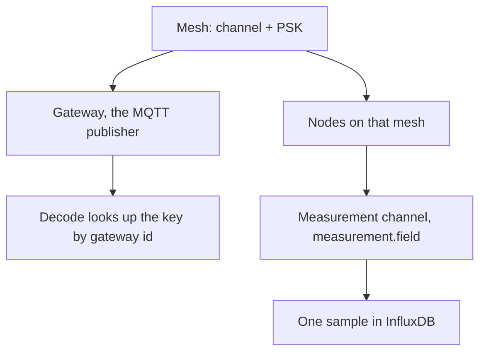

## Mesh

A mesh is one physical Meshtastic network. Before the tables, the shape of the thing:

<Callout type="info" title="Two channels">
The Meshtastic channel is the radio name plus the key. A measurement channel is one quantity on one device, such as `environment_metrics.temperature`. The rest of these pages mean the second one unless they say radio.
</Callout>

A mesh has a channel name and a pre-shared key (PSK). Decode uses that pair to turn ciphertext into readings. The PSK is write-only on the API after it is stored: the owner can see it in the console, and the readings role in the database cannot.

A mesh is **public** when any verified owner, and an anonymous caller of the API, may read its devices and readings. Public never widens writes. Only the owner, or a superuser, can change the mesh, reject a node, or see rejected nodes.

Traffic arrives on this instance's own broker, or through a [source](/docs/sources): a remote broker and topic that an operator bridges in.

## Gateway and node

A **device** is one Meshtastic radio, either a gateway or a node.

- A **gateway** is the MQTT publisher. Decode looks up the mesh key by the gateway's node number, so an allowed gateway node number is unique across the whole instance.
- A **node** is any other radio on that mesh. The same node number may exist on two meshes, for example when two sources hear the same radio.

The node number is the Meshtastic id. The console shows it in the hex form a Meshtastic client uses. The registration id (a UUID) is how the API addresses that row.

`is_allowed = false` rejects a device. Decode drops its packets. Rejection is not deletion: the row stays, and the fact is published so every decoder agrees.

## Channel

Two different things share this word.

- The **Meshtastic channel** is the radio channel name plus the PSK. It belongs to the mesh.
- A **measurement channel** is one quantity on one device, named `measurement.field`. `environment_metrics.temperature` is a channel. Blueprints, quality checks, Flink keys, and Influx fields all use that same string.

A **telemetry variant** is one protobuf shape (`telemetry:environment_metrics`) or a fixed kind such as `device:position`. The catalog says which quantities that variant can produce. The first time a device actually sends that variant, the platform opens those channels for it.

## Reading

A reading is one numeric sample, stored in InfluxDB with the mesh id and the node id. Derived channels, quality metrics, and alarms are readings too, written under their own measurement names. See [Data stores](/docs/data).

## Owner, operator, staff

| Role | What they can do |
| --- | --- |
| Member (owner) | Create meshes and devices they own. Read public meshes. Request the operator role. |
| Operator | Everything a member can, plus sources, sinks, and the Parquet archive on their own meshes. |
| Staff | Read the catalog. No PSK, no writes. |
| Superuser | Read and write every mesh, including keys. Approve operator requests and watch scheduled deletions. |

An operator is still the owner of their own meshes. The extra powers are about shared ingest and about handing data to someone else.

## Source and sink

A **source** pulls. It is a remote MQTT broker whose matching topics are bridged into this instance.

A **sink** pushes. It is a set of credentials on this instance's broker. An outside consumer subscribes and receives the streams the operator selected: decoded readings, derived channels, alarms, or any combination.

The archive is a sink of a different kind: hourly Parquet in object storage, switched on per device.
