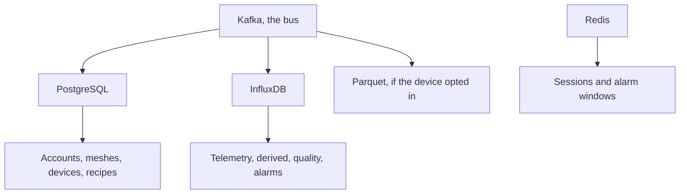

Four stores. PostgreSQL is the fleet. InfluxDB is the samples. Parquet is the opt-in archive. Redis is cache, sessions, and short-lived alarm windows. Kafka is the bus between them, not a store of record.

Lose Redis and you lose sessions and an in-flight alarm batch. Lose Kafka and the pipeline stalls. The fleet and the samples are the two you can rebuild a picture from.

<Callout type="info" title="The readings role cannot see a key">
It is granted the mesh id, the owner, and whether the mesh is public. It is not granted `psk_b64`.
</Callout>

## PostgreSQL

Primary keys are UUIDs unless noted. The auth user model is `owners`.

| Table | Holds |
| --- | --- |
| `owners` | Email, name, API-key hash, verification and reset tokens, alarm-mail cooldown, role (`member` or `operator`) |
| `operator_requests` | One pending request per owner, then the decision |
| `terms_acceptances` | Append-only proof of which text was accepted, for account, mesh, source, or sink. The acceptor is snapshotted so the row survives deletion |
| `sources` | Remote broker, topic, write-only password. `paused_at` when terms lapsed |
| `meshes` | Channel, PSK, owner, public flag, optional source, gateway discovery |
| `devices` | Node number, gateway flag, allowed flag, intervals, identity, position, archive opt-in |
| `traceroutes` | One row per traceroute packet on a mesh |
| `rf_links` | One directed hop per observation source |
| `sinks`, `mesh_sinks`, `device_sinks` | What is published, and from which meshes or devices |
| `sink_instructions` | Append-only on/off record for the archive and for each MQTT sink |
| `data_deletions` | A mesh's readings, scheduled for deletion after a grace period |
| `postprocessing_blueprints`, versions, steps | The recipe. Steps belong to a version |
| `device_postprocessings`, input bindings, step calibrations, backfills | The recipe applied to one device |
| `telemetry_variants`, `measurement_types` | The catalog. A type is unique on `(payload_kind, field_name)` |
| `device_telemetry_variants`, `measurements` | What this device has actually reported, and the detector override |

`quantity_kind` is `physical_property`, `concentration`, `count`, `ratio`, or `other`. An optional `vocabulary_uri` points at a QUDT or EIONET concept.

Cardinality, in short: an owner has many meshes and many blueprints. A mesh has many devices. A device has many channels, and any number of postprocessings. A public blueprint can be attached by someone who does not own it; editing it stays with its owner.

The readings role is granted `id`, `owner_id`, and `is_public` on meshes, and the address columns on devices. It cannot select `psk_b64`.

## InfluxDB

The bucket comes from `INFLUX__BUCKET` (default `telemetry`). A channel is `measurement.field`. `payload_kind` is always `namespace:measurement`, and the measurement half is the Influx measurement name.

| Namespace | Measurement | Origin | Typical fields |
| --- | --- | --- | --- |
| `telemetry` | Protobuf variant name (`environment_metrics`, …) | Measured | Numeric leaves of that sub-message |
| `device` | `position` | Device | `latitude`, `longitude`, `altitude` |
| `device` | `nodeinfo` | Device | `user_id`; tags for the long name, short name, hardware, role |
| `computed` | `derived` | Blueprint | Outputs, tagged `blueprint_id` |
| `computed` | `quality` | Completeness | Fill ratio and gap metrics |
| `computed` | `alarms` | Detectors | `message`, optional `value` |

Common tags on telemetry points: `mesh_id`, `node_id`, and optionally `channel_id` and `gateway_id`. Every point also carries `packet_id` and `timestamp_quality` (`rx_time` or `payload`). Alarm points use tags `detector`, `mesh_id`, `node_id`, optional `channel`, and `source` (`stream` or `batch`).

Text messages and routing packets are not written.

## Parquet

Prefix from `S3_WRITER__PREFIX` (default `telemetry`). One object per mesh and UTC hour. Columns include `node_id`, `packet_id`, `portnum`, `rx_time`, `hop_start`, `channel_id`, `gateway_id`, `payload_kind`, and `payload_json`. A rewritten partition is deduplicated on `(node_id, packet_id, rx_time, payload_kind)`.

Only devices with `archive_enabled` are written. See [Archive](/docs/archive).

## Redis

- Django cache and sessions: registry on database 0, readings on database 1.
- Celery broker for the quality worker on database 2.
- Alarm email windows: a sorted set of open windows and a hash of the alarms held for each device.

Redis is not a domain model. Losing it drops sessions and in-flight alarm batches. It does not drop the fleet or the samples.
