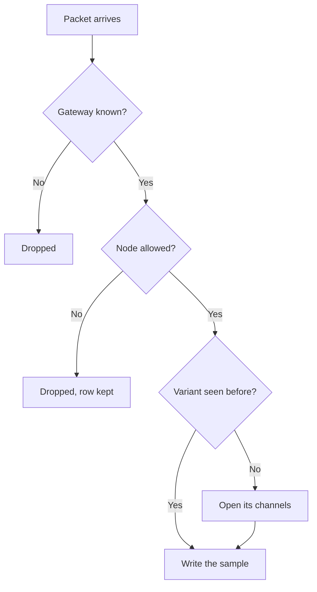

Register a device with `POST /devices` from the mesh page: the Meshtastic node number, whether it is a gateway, and an optional label. Decode also upserts devices from packets it can already decrypt, and gateway discovery can register gateways when the mesh allows it.

Decode asks two questions before a packet becomes a row. Fail either one and the sample never lands.

<Callout type="info" title="Rejecting is not deleting">
`is_allowed = false` publishes the node so every decoder drops it. The row stays, so you can allow it again. Public readers do not see rejected devices.
</Callout>

The inventory at `/console/devices` lists every device you can see. Filter by mesh, gateway, allowed, and whether a blueprint is attached. Open a row for the device page.

## Gateway or node

`is_gateway` marks the MQTT publisher. Its node number is how decode finds the PSK, so two allowed gateways cannot share a node number anywhere on the instance. Ordinary nodes only have to be unique inside their mesh.

Up to three Meshtastic admin keys (`admin_keys_b64`) can be stored on a device. Only the mesh owner sees them. They match the firmware limit of three `admin_key` entries.

## Allowed and rejected

`is_allowed = false` publishes the node on `mesh.node_rejections.v1`. Decode drops those packets. The device stays in the registry so you can allow it again. Public readers do not see rejected rows.

## Name, role, and place

NodeInfo fills `name`, `short_name`, `hardware_type`, and `role` until you set `nodeinfo_overridden`. Position fills latitude and longitude until you set `location_overridden`. After the flag is set, later packets do not overwrite what you typed.

`last_seen` is the last time decode heard the device. `discovered_at` is set when gateway discovery created the row rather than you.

## Intervals

`reading_interval_seconds` is how often the sensor is expected to sample. Detectors and blueprint alignment use it. `publish_interval_seconds` is how often the radio is expected to send. The absence detector compares silence against that interval.

Leave them empty when you do not know yet. The catalog variant can carry a default reading interval until the device has its own.

## Channels on this device

The device page lists telemetry variants (`GET /devices/{id}/telemetry-variants`) and the live channels (`GET /devices/{id}/measurements`). A channel appears when that variant is first seen. You do not create `environment_metrics.temperature` by hand.

On each channel:

- `enabled_detectors = null` inherits the catalog default.
- `enabled_detectors = []` silences detectors on that channel.
- `valid_min` and `valid_max` are set together for the range detector. Both empty means range is not checked.

Absence is not a per-channel switch. It is `absence_detection_enabled` on the device. See [Quality and alarms](/docs/quality).

## Archive

`archive_enabled` opts this device into the Parquet archive. The API accepts it only on a mesh whose owner is an operator, and only when the instance has an archive. Turning it off stops new objects and keeps what was already written. The console calls this switch **S3 storage**. See [Archive](/docs/archive).
