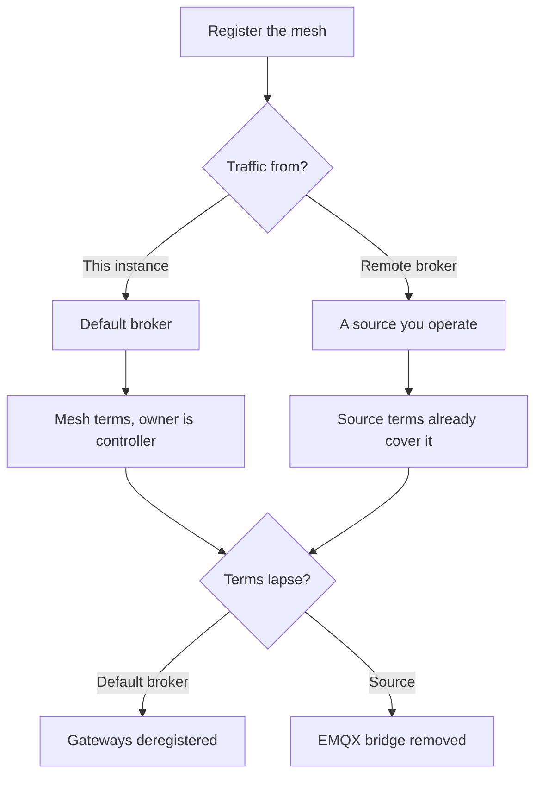

A mesh is registered with `POST /meshes`: a channel id, a PSK, and an optional label. The key is published on the compact Kafka topic `mesh.keys.v1`, keyed by gateway id, so decode can decrypt without asking the API on every packet.

Where the packets come from decides which terms apply, and what happens when those terms lapse.

<Callout type="warn" title="Public is read-only">
`is_public` lets other people, and anonymous API callers, read devices and history. It never lets them edit the mesh, see the PSK, or see a node you rejected.
</Callout>

The console lists your meshes at `/console/meshes`. Open one to see its gateways and nodes together.

## Who can read and write

| Action | Who |
| --- | --- |
| Read devices and readings | The owner, a superuser, and anyone if `is_public` is set. Anonymous API callers see public meshes only. |
| See the PSK | The owner and a superuser. Staff never see it. A public reader does not. |
| See rejected nodes | The owner and a superuser. |
| Edit, delete, register devices | The owner and a superuser. |

## Where the traffic comes from

`source` is null when packets arrive on this instance's own broker topic. An operator can point the mesh at one of their [sources](/docs/sources) instead. Moving a mesh off a source, or deleting the mesh, schedules its stored readings for deletion after a grace period. Superusers watch those jobs under **Management → Scheduled deletions**.

On the default broker, mesh terms apply to the owner as controller of that traffic. On a source, the source's terms apply and the mesh form does not ask again. If terms lapse:

- Default broker: the mesh is paused and its gateways are deregistered until the owner renews.
- Source: the EMQX bridge for that source is removed until the operator renews.

The console status column orders the urgent states first: scheduled for deletion, source paused, source disconnected, terms changed, renew soon, terms not yet accepted, source status unknown, then active. A lite instance that does not enforce terms shows meshes as active unless the bridge itself is unhealthy.

## Discovering gateways

`discover_gateways` lets the platform register gateways whose packets decrypt with this mesh's channel and PSK, without the owner adding each one. Discovery is paced (about 50 gateways a minute) so a busy broker cannot flood the registry. Nodes under a discovered gateway are still upserted from decode sightings.

A device row created this way has `discovered_at` set. You can still reject it.

## Public meshes

Turn `is_public` on when viewers should read the fleet and the history. They cannot change it, they cannot see the PSK, and they cannot see devices you have rejected.

## Deleting a mesh

Deleting a mesh does not erase readings in the same request. A data-deletion job is scheduled, with a reason of `mesh_deleted`, and runs after `delete_after`. The same happens when a mesh leaves its source (`source_detached`) or when source terms lapse (`terms_lapsed`). Renewing terms, or putting the mesh back on that source, can cancel a pending job.
