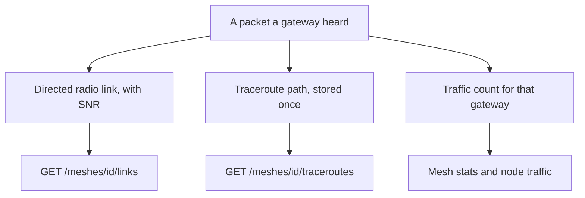

Decode does more than store sensor values. It also keeps a picture of the radio network: which nodes heard which, the path a traceroute took, and how much traffic each gateway is carrying.

One packet can feed three pictures. They answer different questions, so they are not interchangeable.

<Callout type="info" title="Busy is not sensed">
Traffic counts packets. A node can be loud on the mesh and still have no temperature channel.
</Callout>

## Radio links

`GET /meshes/{id}/links` returns one directed hop: `from_node` transmitted, `to_node` measured the SNR. A link is counted separately for each way it was observed:

| Source | Meaning |
| --- | --- |
| `traceroute` | A hop named in a traceroute |
| `neighborinfo` | A neighbor report |
| `direct` | A packet heard straight from the sender |

Each row keeps the sample count, the SNR sum, the last SNR, and the first and last time it was seen. SNR is in dB, and it is null where the packet did not measure it. Traceroute SNR values past the known path are ignored rather than failing the packet.

## Traceroutes

`GET /meshes/{id}/traceroutes` returns the path packets. A traceroute is stored once, however many gateways heard it. `from_node` sent the packet and `to_node` was the destination. On a reply (`request_id` set) that pair is the reverse of the traceroute's own direction. `route` and `route_back` are node numbers; `snr_towards` and `snr_back` line up with them. `gateway_ids` lists who heard this copy.

## Traffic

Every packet a registered gateway hears is counted.

- `GET /readings/meshes/{id}/stats` is the mesh: gateway overlap, relays, activity.
- `GET /readings/devices/{uuid}/traffic` and the node-number twin are one node's packet types and volume.

These numbers describe the radio, not the sensor catalog. A node can be busy on the mesh and still have no temperature channel.
