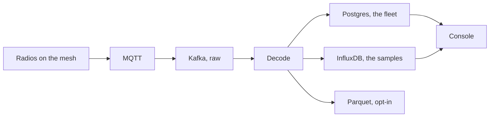

Mesh Things turns a [Meshtastic](https://meshtastic.org/) LoRa mesh into a managed fleet. Gateways publish protobuf packets to MQTT. This platform decrypts them with the mesh key, stores the readings, and lets the owner query and configure the fleet over HTTP and in the console.

A packet does not land in one box. Each stage keeps a different promise: the bus remembers the envelope, Postgres remembers the fleet, InfluxDB remembers the samples.

<Callout type="warn" title="One decoder">
`lite` and `full` both read the same raw topic. Pick one. Running both makes two consumers compete for the same packets.
</Callout>

## Who it is for

- Owners who run one or more meshes and want a durable record of sensor data.
- People who need to know when a node goes silent, a sensor sticks, or a value leaves a valid range.
- Teams that derive extra channels from raw readings, with a calibration that can change over time.
- Operators who bridge a remote MQTT broker in, or hand a subset of readings to someone else.
- Viewers who should read a public mesh and change nothing on it.

## What happens to a packet

1. **Ingest.** An MQTT bridge copies traffic into Kafka as a raw envelope. The broker can be this instance's own, or a remote broker registered as a [source](/docs/sources).
2. **Decode.** A Python consumer (`lite`) or a Flink job (`full`) decrypts with the mesh pre-shared key and emits structured JSON. Unknown gateways and rejected nodes are dropped.
3. **Catalog.** Sightings and sensor discovery upsert devices, telemetry variants, and measurement channels in PostgreSQL.
4. **Store.** Decoded events go to InfluxDB. On a full deployment, devices that opt in are also archived as hourly Parquet.
5. **Process.** The full profile applies stream detectors. A batch worker runs blueprints and completeness checks over stored history.
6. **Serve.** Caddy routes the registry API (accounts, meshes, devices, catalog) and the readings API (series, latest values, exports, archive). The console is the interface on top of both.

## Two deployment sizes

| Mode | Typical host | What you get |
| --- | --- | --- |
| `lite` | A single-board computer | MQTT ingest, Python decode, InfluxDB, both APIs |
| `lite` + `quality` | Same, with more CPU | Batch blueprints and completeness analysis |
| `full` | A larger machine | Flink streams, sinks, and the batch worker. Add `minio` to keep the Parquet archive on the bundled store |

`lite` and `full` are alternatives for decode. Running both at once makes them compete for the same raw topic.

## Where each kind of data lives

| Concern | Store |
| --- | --- |
| Accounts, meshes, keys, devices, catalog, blueprints | PostgreSQL |
| Telemetry, positions, node info, derived channels, quality, alarms | InfluxDB |
| Decoded-event archive, when a device opts in | S3 or MinIO, as Parquet |
| Sessions, rate limits, alarm-email windows | Redis |
| In-flight events and the current decrypt config | Kafka |

The live HTTP contract is the registry's OpenAPI document at `/schema`, with Swagger UI on the API host. That API document is separate from this console guide.

## Read next

<Cards>
  <Card title="Concepts" href="/docs/concepts" description="Mesh, gateway, node, and the two meanings of channel." />
  <Card title="Accounts" href="/docs/accounts" description="Sign-up, the session cookie, and who may see a PSK." />
  <Card title="Architecture" href="/docs/architecture" description="Profiles, services, and the Kafka topics between them." />
  <Card title="Data stores" href="/docs/data" description="What Postgres, InfluxDB, Parquet, and Redis each keep." />
</Cards>
