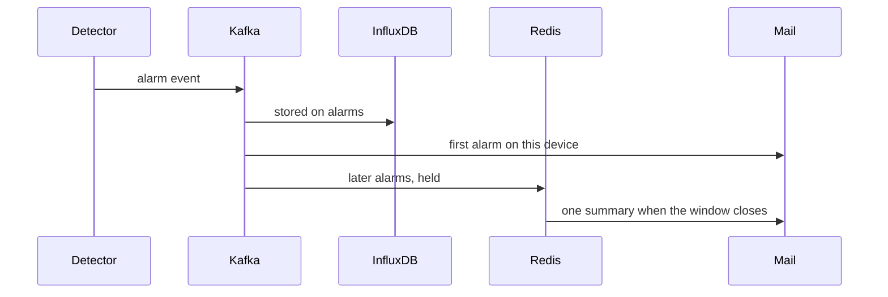

Detectors are listed by `GET /detectors`. A channel runs the ones in `enabled_detectors`, or the catalog default when that field is null. An empty list silences the channel. Absence is the exception: it is a switch on the device, because silence is about the radio, not about one field.

An alarm is not an email. The event is written first. Mail is a later decision, and it batches.

<Callout type="warn" title="Three detectors need full">
`flat_value`, `range`, and `absence` run on Flink. A lite box does not run them. Completeness and blueprints can still run if you add the `quality` profile.
</Callout>

| Detector | Scope | Where it runs | What it needs |
| --- | --- | --- | --- |
| `flat_value` | Channel | Flink pattern job, full profile | A reading interval. The window is about three hours of samples. |
| `range` | Channel | Flink pattern job, full profile | `valid_min` and `valid_max` on that channel, set together. |
| `absence` | Device | Flink absence job, full profile | `absence_detection_enabled` and `publish_interval_seconds`. |
| `completeness` | Channel | Quality worker, batch | `reading_interval_seconds`. Alarms when the fill ratio is low or a gap is long. |

`lite` does not run the Flink jobs. Add the `quality` profile if you still want completeness and blueprints on a small machine. `flat_value`, `range`, and `absence` belong to `full`.

Alarm events are JSON on `mesh.telemetry.alarms.v1`. The Influx writer also stores them in the `alarms` measurement, tagged with the detector, the mesh, the node, an optional channel, and `source` (`stream` or `batch`).

## Email

The first alarm on a device emails the mesh owner immediately. Later alarms on that same device, whatever the detector or the channel, are held in Redis for `alarm_email_cooldown_seconds`. When the window closes, one summary mail lists what was held. A cooldown of 0 emails every alarm.

The owner can override the server default from their profile. Mail uses the console's HTML style and links back to the console (`REGISTRY__PUBLIC_FRONTEND_URL`). Owners are also reminded daily while alarms are still ongoing.

`GET /status/email` lets the monitor check that sending works. It is an operations endpoint, not a console page.

## What the console shows

**Automation → Alarms** is where you choose what to watch on each measurement. The device page is where a channel inherits, overrides, or silences that choice, and where absence is switched for the whole device.
