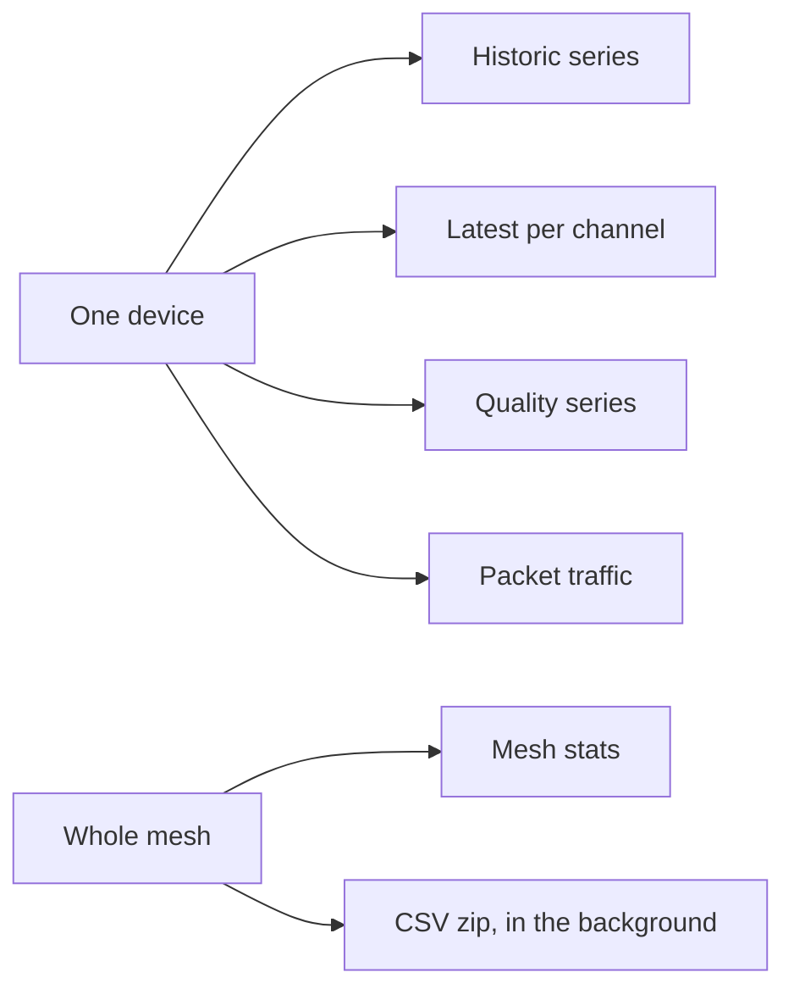

Readings live in InfluxDB. The readings API never returns the mesh PSK. You can query by the device's registration id, or by mesh id plus Meshtastic node number.

Same store, four questions. Pick the path that matches the question, not the screen you happen to be on.

<Callout type="info" title="One download at a time">
A second export while one is still preparing comes back as 429. The link lives 24 hours. After that the file is gone and you ask again.
</Callout>

| Question | Path |
| --- | --- |
| Historic samples | `GET /readings/devices/{uuid}` or `GET /readings/meshes/{mesh}/nodes/{node}` |
| Latest value per channel | `.../latest` |
| Quality series | `.../quality` |
| Packet traffic for one node | `.../traffic` |
| Mesh-wide traffic | `GET /readings/meshes/{mesh}/stats` |

Query a series with `channel`, `start`, `stop`, `window`, and `agg`. The device page defaults to the last 24 hours, a one-hour window, and a mean, and it prefers `environment_metrics.temperature` when that channel exists.

`start` and `stop` accept a time or a relative value such as `-24h`. `window` is the bucket size. `agg` is the reducer inside the bucket (`mean` and the other reducers the API lists).

Latest values are the cards at the top of the device page: value, unit, quantity kind, and time. An empty lookback is an empty state, not a zero.

## CSV downloads

Any mesh owner can take readings away as CSV. Superusers can too. The device page has **Download CSV** for that one device. `/console/csv-downloads` (under **Data**) can cover a whole mesh or a chosen subset.

One download is a zip, built in the background.

| Limit | Value |
| --- | --- |
| Longest range | 366 days |
| In preparation at once | One. A second request is 429. |
| Link lifetime | 24 hours. You get mail when it is ready. |
| Listed so you can ask again | 30 days |

States are `queued`, `running` (with days done of days total), `ready` (a signed URL until `expires_at`), `failed` (an error string), and `expired` (the file is gone; request it again).

Parquet exports of the archive use the same job machinery with `format: parquet`. See [Archive](/docs/archive).

## Rate limits

Readings are throttled per owner. Superusers are not throttled.
