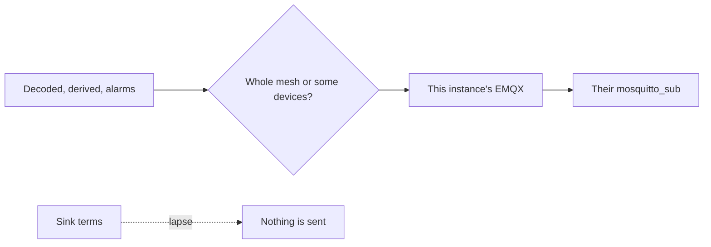

A sink is the opposite of a source. An operator publishes readings onto this instance's EMQX broker, and a consumer they choose subscribes with its own username and password. The password lives hashed in EMQX. The API shows it once, when it is set or rotated.

You choose the stream and the radios. The consumer never sees the mesh key.

<Callout type="warn" title="The password is shown once">
Issuing a new password disconnects whoever is connected now. Deleting the sink revokes the credentials. You cannot delete a sink that still has meshes or devices attached.
</Callout>

Sinks need EMQX. On a deployment without it, every sink route answers 404 and the console says so. The `sinks` profile turns them on for a lite stack; `full` includes them.

Only operators and superusers manage sinks, and an operator sees only the ones they created. The page is `/console/sinks`, next to Sources and Archive.

## What is sent

`streams` is a non-empty subset of `decoded`, `derived`, and `alarms`, stored in that order.

**Send from** is either:

- a whole mesh, including nodes that appear later, or
- individual devices

Checking the mesh disables the device checkboxes ("included with the mesh"). Unchecking it restores any device picks you had made, and those picks are what get stored. On edit, each list you send replaces the current one. Credentials do not change on edit.

The mesh or device has to be one you can edit, and the mesh owner has to be an operator. A superuser can attach sinks on an operator's meshes.

## Credentials

Create, and **Issue a new password**, return the password once: broker, username, password, and topic filter, plus a `mosquitto_sub` line that keeps a persistent session. Issuing a new password disconnects current consumers. Deleting the sink revokes the credentials.

You cannot delete a sink that still has meshes or devices attached. The API answers 409; edit it and clear them first.

## Terms

Each create accepts the current sink terms. The operator is responsible for what the sink sends and for whom they give the credentials to. If acceptance lapses, `paused_at` is set: nothing is sent, and the consumer is refused, until the creator renews.

The list shows whether it is sending or paused, how many meshes and devices it covers, and how many consumers are connected now. Connections show as an em dash when the broker does not answer.
