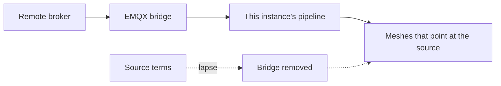

A source is a remote MQTT broker and a topic filter. EMQX on this instance subscribes and copies matching traffic into the pipeline. Only operators and superusers manage sources. An operator sees the ones they created. A superuser sees all of them. Everyone else gets 403, and the **Data** menu hides the page. Opening `/console/sources` directly sends them back to meshes.

A source pulls. Nothing is stored until the bridge is actually up, and the bridge comes down again when the terms lapse.

<Callout type="warn" title="A failed bridge stores nothing">
If EMQX cannot build the bridge, the API returns 502 and the source is not saved. On edit, a 502 means the stored source is unchanged.
</Callout>

A member asks for the operator role from their profile. See [Accounts](/docs/accounts).

## What you register

| Field | Rule |
| --- | --- |
| Label | Optional name in the list |
| Server | `host:port` |
| Topic | The filter to bridge. `$share` and `$SYS` are rejected. |
| TLS | On by default |
| Username and password | The password is write-only. It is never returned. |
| QoS | 0 or 1. Default 1. |

Creating a source accepts the current source terms (`GET /sources/terms`) and sends `terms_version`. The operator is the controller of the bridged traffic; Sensical is the processor. Acceptance is a contract with the operator, recorded with the exact text hash, and it is asked on every create, not on edit. A lite instance that does not enforce terms skips the step.

If EMQX cannot build the bridge, the API returns 502 and stores nothing.

## Meshes on a source

On create or edit mesh, an operator chooses **Default broker** or one of their sources. `source_id: null` is the default broker. The list shows the source name on meshes you own. Someone else's mesh shows no source id.

You cannot delete a source that still has meshes. The dialog lists them and links each one. Move them off first.

## Pause, renew, disconnect

Source terms can expire. When they lapse, `paused_at` is set, the bridge is removed, and meshes on that source stop ingesting until the creator renews (`POST /sources/{id}/terms-acceptance`). The list shows status and a Renew action for the creator when the source is paused, expiring soon, or bound to a changed text.

Editing the password: leave it unchanged, send a new value, or send an empty string to clear it. A 502 on edit means the bridge was not reconfigured and the stored source is unchanged.

Busy sources can email the operator who created them, and superusers, when they stay above the rate the instance allows.
