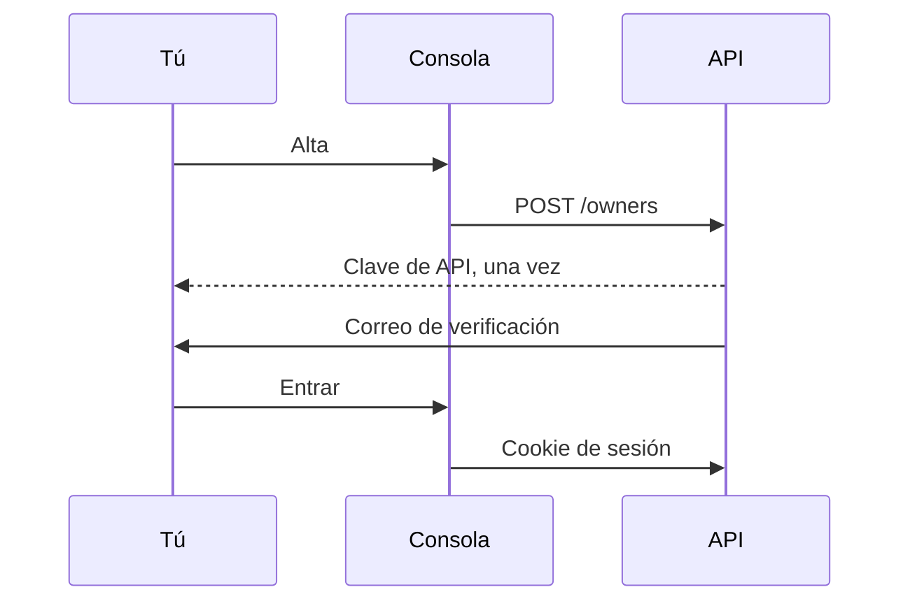

Una cuenta es un **dueño**. El correo es el nombre de usuario. `is_active` significa que el correo está verificado.

Darse de alta y entrar son dos puertas distintas. La clave es para scripts. La cookie es para la consola. Ninguna de las dos se guarda en el navegador como un secreto que luego vuelves a pegar.

<Callout type="warn" title="La clave se muestra una vez">
Rótala y la clave vieja muere. La base de datos guarda un hash SHA-256, no la clave. Si cierras el diálogo, genera otra.
</Callout>

## Crear una cuenta

`POST /owners` crea la cuenta y devuelve una clave de API una sola vez. El alta de la consola está en `/signup`.

Cuando la instancia exige condiciones (`REGISTRY__TERMS_ENFORCED`), el alta también pide aceptar las condiciones de uso y la política de privacidad. Las condiciones de cuenta no caducan. Se vuelven a pedir solo cuando cambia el texto. Una instancia lite que no exige condiciones se salta este paso; `GET /terms` responde 404 y la consola oculta las casillas.

Hasta que la dirección está verificada, la cuenta no pasa las comprobaciones habituales. El enlace de verificación llama a `GET /owners/verify-email`. Puedes pedir otro mensaje con `POST /owners/me/resend-verification`.

## Entrar

La consola te identifica con una cookie de sesión: `POST /owners/login` y `POST /owners/logout`. Los dueños sin verificar también pueden entrar, para terminar la verificación. El acceso está limitado por IP de cliente y por correo. Los intentos fallidos caducan; no son un contador permanente.

La API de lecturas acepta la misma cookie. Los dos roles de API comparten un secreto, así que una cookie emitida por el registro sigue siendo válida allí.

Los scripts usan `Authorization: Bearer` y la clave de API. Se rota con `POST /owners/me/rotate-key`. La clave nueva se muestra una vez. La base de datos guarda solo un hash SHA-256.

Restablecer la contraseña es un token en el cuerpo de la petición (`POST /owners/request-password-reset`, luego `POST /owners/reset-password`). Cámbiala con la sesión abierta en `POST /owners/me/change-password`.

## Roles

| Rol | Cómo se obtiene | Poder extra |
| --- | --- | --- |
| Miembro | Alta | Sus mallas, dispositivos y plantillas |
| Operador | Un superusuario aprueba la petición | Fuentes, destinos y archivo |
| Staff | Concedido en el servidor | Lee el catálogo, sin secretos y sin escrituras |
| Superusuario | `createsuperuser` | Todas las mallas, todas las claves, el admin de Django en `/admin/` |

Pide el rol de operador desde **Perfil**. Una petición pendiente por dueño. Un rechazo permite volver a pedir. Los superusuarios deciden en **Gestión → Peticiones de operador**. Aprobar pone `role` en `operator`.

## Qué puedes ver

Un dueño verificado lee sus mallas y cualquier malla marcada como pública. Un superusuario lo lee todo. Las escrituras no siguen la marca de pública.

Staff lee el catálogo y no ve las PSK. Los operadores ven solo las fuentes y los destinos que crearon, salvo que sean superusuario, que los ve todos.

## Correo de alarma de esta cuenta

`alarm_email_cooldown_seconds` en `PUT /owners/me` sustituye el valor por defecto del servidor: cuánto se retienen las alarmas de un dispositivo antes del correo resumen. Null significa "usar el valor del servidor". Ver [Calidad y alarmas](/docs/quality).

Dos interruptores más hablan de la infraestructura que creaste, no de las alarmas de sensor:

- `status_alerts_enabled` — correo cuando una fuente o un destino que creaste sigue desconectado o sin uso.
- `source_rate_alerts_enabled` — correo cuando una fuente que creaste sigue más ocupada de lo que la instancia permite. Los superusuarios también reciben aviso cuando una fuente está inusualmente ocupada.
