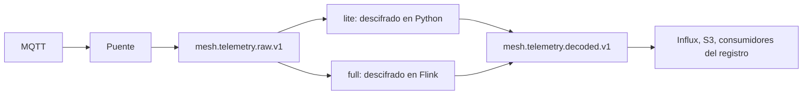
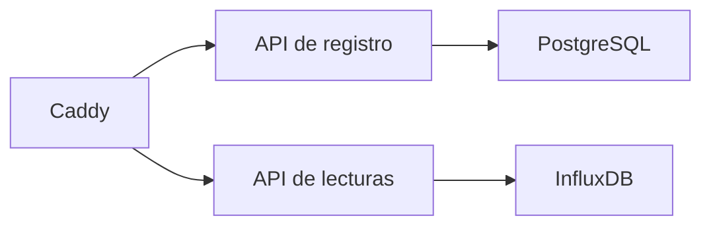

Todo está declarado en ficheros de Compose bajo `compose/`, incluidos desde `docker-compose.yml`. Producción solo escucha en loopback, salvo Caddy en `80` y `443`. La capa de desarrollo publica los puertos de las interfaces de administración y cambia Django a los ajustes `dev`. `env.example` enciende esa capa; un `.env` de producción borra la línea `COMPOSE_FILE` y pone `COMPOSE_PROFILES` en su lugar.

Caddy es la única puerta pública. Detrás, el topic en bruto se parte por perfil, y las dos APIs no comparten un rol de base de datos.



Caddy es otra puerta. No descifra paquetes. El registro responde desde PostgreSQL. Las lecturas responden desde InfluxDB.



<Callout type="warn" title="No arranques los dos descifradores">
`lite` y `full` compiten por `mesh.telemetry.raw.v1`. El resto de perfiles (`quality`, `sinks`, `minio`, `monitor`) se apilan encima de uno de ellos.
</Callout>

Las dos claves secretas de las APIs tienen que estar puestas antes de que arranquen. `DJANGO_SETTINGS_MODULE` es `api_project.settings.dev` o `api_project.settings.prod`, nunca el paquete `settings` en sí.

## Perfiles

| Perfil | Efecto |
| --- | --- |
| `lite` | `decode_consumer` en Python en lugar de Flink |
| `full` | Trabajos de Flink, escritor S3, destinos, quality worker |
| `quality` | Worker por lotes en un stack lite |
| `sinks` | Destinos MQTT en un stack lite |
| `minio` | MinIO incluido para el archivo |
| `monitor` | Monitor del servidor, en su propio dominio a través de Caddy |
| `kafka-ui` | Navegador de topics |
| `bridge-pool` | Réplicas extra del puente MQTT |

No arranques `lite` y `full` a la vez. Compiten por `mesh.telemetry.raw.v1`.

```bash
cp env.example .env
docker compose --profile lite up -d
docker compose --profile lite --profile quality up -d
docker compose --profile full --profile minio up -d
```

## Siempre encendido

Kafka, PostgreSQL, Redis, InfluxDB, la API de registro, la API de lecturas, el puente MQTT, el escritor de Influx y Caddy. Tres consumidores del registro siguen en pie con las APIs: avistamientos de dispositivos, descubrimiento de sensores y correo de alarma.

Caddy es la entrada pública. `/readings/*` va a `readings_api`. Todo lo demás, incluido `/schema` y el Swagger `/docs` de la API, va a `registry_api`. Esta guía de la consola es otro sitio.

El rol de lecturas usa un rol de Postgres que no puede seleccionar las columnas de PSK.

## Descifrado

`lite` ejecuta `decode_consumer`. `full` ejecuta en su lugar un trabajo de Flink llamado `mesh-decode-decrypt`, más calibración, detección de patrones y detección de ausencia. El descifrado lee los topics compactos `mesh.keys.v1` (PSK por pasarela) y `mesh.node_rejections.v1`. Un paquete cuya pasarela es desconocida, o cuyo nodo está rechazado, se descarta. Los paquetes permitidos se convierten en JSON con `mesh_id`, `node_id`, `payload_kind` y `payload`.

## Topics de Kafka

Los topics compactos guardan la configuración actual. El resto son un log.

| Topic | Política | Quién escribe | Quién lee |
| --- | --- | --- | --- |
| `mesh.telemetry.raw.v1` | log | Puente MQTT | descifrado |
| `mesh.telemetry.decoded.v1` | log | descifrado | escritor Influx, escritor S3, calibración |
| `mesh.telemetry.calibrated.v1` | log | calibración Flink | detección de patrones |
| `mesh.telemetry.alarms.v1` | log | detectores, quality worker | escritor Influx, correo de alarma |
| `mesh.devices.v1` | log | descifrado | consumidor de dispositivos |
| `mesh.sensor_discovery.v1` | log | descifrado | consumidor de descubrimiento |
| `mesh.keys.v1` | compact | registro | descifrado |
| `mesh.node_rejections.v1` | compact | registro | descifrado |
| `mesh.quality_config.v1` | compact | registro | detectores Flink |
| `mesh.calibration.v1` | compact | registro | calibración Flink |

Los nombres de arriba son los de por defecto. Los topics que se borran tienen un tope de 1 GB.

## Calidad por lotes

`quality_worker` ejecuta plantillas sobre una ventana (7 días por defecto) y comprobaciones de completitud. `quality_worker_beat` programa `scan_devices`, cada hora por defecto. El worker se autentica como superusuario.

## Operación

Cada rol de API tiene `/health`. El registro expone `/metrics`. Las interfaces de administración (Flink, Kafka UI, InfluxDB, MinIO) las hace de proxy inverso Caddy y quedan detrás de credenciales en `caddy/credentials/`. La capa de desarrollo añade MailHog y un sufijo de grupo compartido MQTT para que un portátil no robe el tráfico de producción. Las copias de Postgres e InfluxDB se cifran con age y se guardan 7 días.
