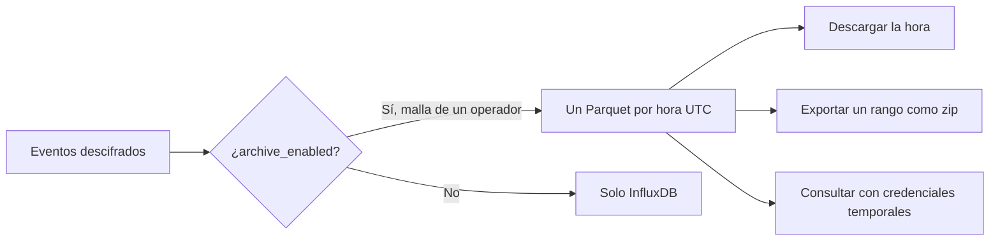

El archivo es una copia a largo plazo de los eventos descifrados, en Parquet sobre S3 o MinIO. Está apagado salvo que el dispositivo lo active. InfluxDB sigue siendo el almacén que leen las gráficas de la consola.

Las gráficas y el archivo no son el mismo estante. Apagar el interruptor deja de escribir ficheros nuevos. No tira los que ya están escritos.

<Callout type="info" title="Lite no tiene archivo">
El listado responde 404 y la consola lo dice. `full` escribe los ficheros. Añade `minio` para guardarlos en el almacén incluido, o apunta el escritor a tu propio bucket.
</Callout>

El archivo existe en un despliegue `full`. Añade el perfil `minio` para guardarlo en el MinIO incluido, o apunta el escritor a un bucket externo y deja `minio` apagado. Una instancia lite no tiene archivo: el listado responde 404 y la consola lo dice.

## Quién puede encenderlo

`archive_enabled` se acepta solo cuando el dueño de la malla es operador, y solo cuando esta instancia tiene archivo. El dueño y los superusuarios ven la marca. Staff y los lectores públicos no.

La consola llama al interruptor **S3 storage**, en el inventario de dispositivos, en las tablas de variantes y en el menú de últimos valores. **Archive** es la página, no el acto de retirar un dispositivo. Apagar el interruptor deja de escribir ficheros nuevos y conserva los ya escritos. Quién lo encendió, y cuándo, se guarda en el dispositivo y, como histórico, en una fila de instrucción que solo se añade (el mismo libro que usan los destinos MQTT).

## Los ficheros

Un objeto por malla y hora UTC:

`{prefix}/mesh_id={uuid}/dt={YYYY-MM-DD}/hour={HH}/data.parquet`

`/console/archive` lista tus mallas (un superusuario también ve mallas que archivan algo y no son suyas) con el recuento de dispositivos, de ficheros, el tamaño y la última hora. Abre una malla para ver qué dispositivos están activos y luego los ficheros: una fila por día UTC, la más reciente primero, que se despliega en una descarga por hora.

Cada hora es una redirección al objeto. Un día entero, o un rango más largo, es un trabajo de exportación con `format: parquet`: un zip con una carpeta por día y `YYYY-MM-DD/YYYY-MM-DD_HH.parquet` dentro. Se aplican los mismos límites que al CSV (366 días, un trabajo a la vez, enlace de 24 horas). Ver [Lecturas](/docs/readings).

## Consultarlo tú

**Command line** en la página de archivo puede emitir credenciales temporales (se muestran una vez, no se revocan antes de tiempo) y rellenar o bien:

- un `COPY` de DuckDB a un único fichero Parquet, o
- un `aws s3 sync` de las carpetas de hora tal como están

Sin STS, emitir credenciales responde 404 y la página ofrece las descargas por fichero. El fragmento de DuckDB usa direccionamiento path-style y pone `USE_SSL` según el endpoint.
