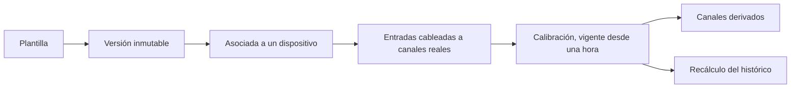

Una plantilla es una receta: una lista ordenada de algoritmos con nombre, de `GET /algorithms`. El dueño la edita en **Automation → Blueprints** (`/console/blueprints`). Ves las tuyas y las públicas.

La receta y el dispositivo se quedan separados a propósito. Editar los pasos no cambia en silencio un dispositivo que ya está corriendo.

<Callout type="info" title="La calibración es del dispositivo">
La receta nombra el algoritmo. El dispositivo guarda los números, con `valid_from`, así que reprocesar datos viejos usa la calibración que estaba en vigor entonces.
</Callout>

## Una versión es inmutable

Cambiar el nombre, la descripción o si la plantilla es pública edita la plantilla en su sitio. Cambiar los pasos crea una **versión nueva**, copiada de la última. Los dispositivos se asocian a una versión, no a "lo que diga hoy la receta", así que un dispositivo en marcha no cambia de fórmula por debajo.

Cada paso tiene:

- una clave y un orden, únicos dentro de la versión
- `function_name`, que tiene que existir en el catálogo de algoritmos
- `inputs`: cada entrada del algoritmo es `slot:<nombre>` o `step:<clave>.<salida>`
- `params` de configuración. Los parámetros marcados como calibración no se ponen aquí.
- `outputs`: cada salida del algoritmo se convierte en un nombre de campo derivado

Renombrar una entrada o un paso reescribe las referencias que lo apuntan. La consola comprueba las mismas reglas que la API antes de enviar el formulario.

## Asociarla a un dispositivo

En la ficha, un postprocesado une una versión de plantilla a ese dispositivo:

- cada entrada se cablea a un canal real de este dispositivo
- `output_prefix` se antepone a cada campo derivado, así la misma plantilla puede correr dos veces
- `tolerance_seconds` es cuánto pueden separarse las muestras y seguir contando como el mismo instante. Null usa la mitad del intervalo de lectura del dispositivo
- `is_enabled` lo arranca y lo para

Los canales derivados aparecen como medidas con `produced_by` apuntando a ese postprocesado. Su tipo de catálogo se elimina cuando desaparece el último canal que lo usaba, para que una unidad vieja no bloquee una asociación posterior.

## Calibración

La calibración es del dispositivo, no de la receta. `StepCalibration` es solo de añadir: una clave de paso, el nombre del algoritmo, los parámetros y `valid_from`. Reprocesar datos viejos usa la calibración que estaba en vigor en ese momento. Una calibración se aplica solo mientras el paso sigue ejecutando el mismo algoritmo.

La calibración en flujo, en el perfil completo, lee el topic compacto `mesh.calibration.v1` y escribe `mesh.telemetry.calibrated.v1`. Una función mala se registra y el valor en bruto pasa tal cual.

## Recalcular el histórico

Un `POST` de backfill vuelve a ejecutar la receta sobre un rango guardado. El quality worker reclama el trabajo. `include_dependants` también vuelve a ejecutar los postprocesados que leen las salidas de este, en orden. El estado pasa por `pending`, `running`, `done` y `failed`. La fila anota cuántos puntos se publicaron.

El ejecutor por lotes carga los canales de Influx necesarios en la ventana, los alinea al intervalo de lectura, corre los pasos en orden y escribe el measurement `derived` etiquetado con la plantilla. Los algoritmos punto a punto pueden correr por muestra. Los de ventana se quedan en el lote.

El worker entra en el registro como superusuario para poder ver los dispositivos de todos los dueños.
