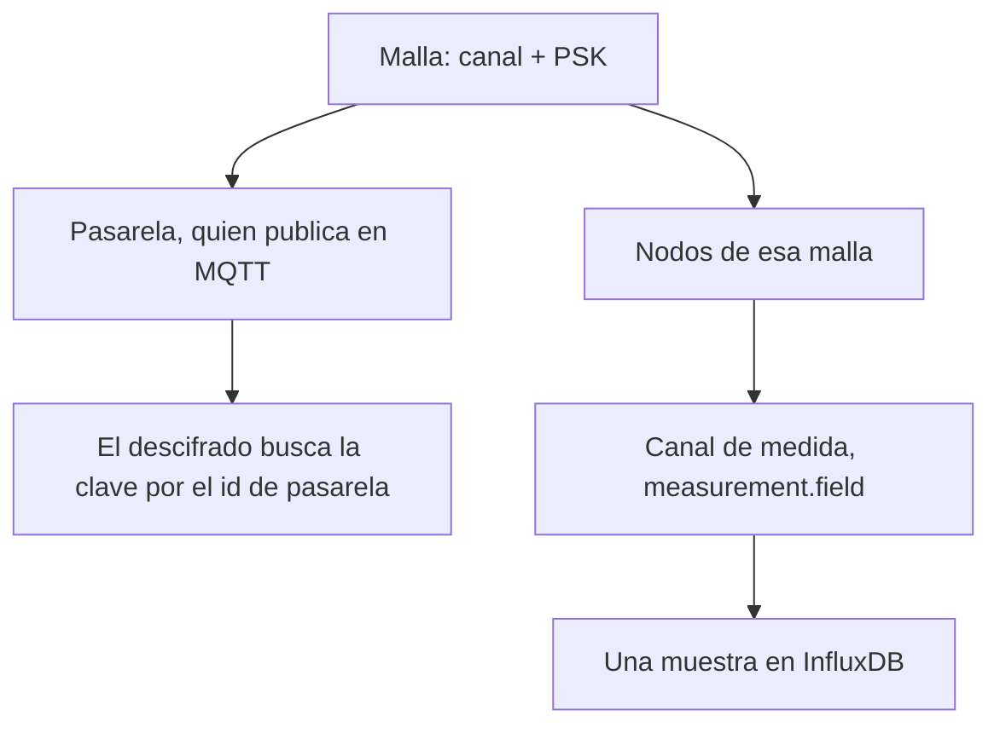

## Malla

Una malla es una red Meshtastic física. Antes de las tablas, la forma de la cosa:

<Callout type="info" title="Dos canales">
El canal Meshtastic es el nombre de radio más la clave. Un canal de medida es una magnitud en un dispositivo, como `environment_metrics.temperature`. El resto de estas páginas habla del segundo, salvo que digan radio.
</Callout>

Tiene un nombre de canal y una clave precompartida (PSK). El descifrado usa ese par para convertir el cifrado en lecturas. La PSK es de solo escritura en la API una vez guardada: el dueño puede verla en la consola, y el rol de lecturas en la base de datos no puede.

Una malla es **pública** cuando cualquier dueño verificado, y una llamada anónima a la API, puede leer sus dispositivos y lecturas. Público no amplía las escrituras. Solo el dueño, o un superusuario, puede cambiar la malla, rechazar un nodo o ver los nodos rechazados.

El tráfico llega por el bróker de esta instancia o por una [fuente](/docs/sources): un bróker remoto y un topic que un operador trae en puente.

## Pasarela y nodo

Un **dispositivo** es una radio Meshtastic, pasarela o nodo.

- Una **pasarela** es quien publica en MQTT. El descifrado busca la clave de la malla por el número de nodo de la pasarela, así que un número de pasarela permitida es único en toda la instancia.
- Un **nodo** es cualquier otra radio de esa malla. El mismo número de nodo puede existir en dos mallas, por ejemplo cuando dos fuentes oyen la misma radio.

El número de nodo es el id de Meshtastic. La consola lo muestra en el hexadecimal que usa un cliente Meshtastic. El id de registro (un UUID) es como la API nombra esa fila.

`is_allowed = false` rechaza un dispositivo. El descifrado tira sus paquetes. Rechazar no es borrar: la fila se queda, y el hecho se publica para que todos los descifradores coincidan.

## Canal

Esta palabra nombra dos cosas distintas.

- El **canal Meshtastic** es el nombre de canal de radio más la PSK. Pertenece a la malla.
- Un **canal de medida** es una magnitud en un dispositivo, con el nombre `measurement.field`. `environment_metrics.temperature` es un canal. Las plantillas, los controles de calidad, las claves de Flink y los campos de Influx usan esa misma cadena.

Una **variante de telemetría** es una forma de protobuf (`telemetry:environment_metrics`) o un tipo fijo como `device:position`. El catálogo dice qué magnitudes puede producir esa variante. La primera vez que un dispositivo envía de verdad esa variante, la plataforma abre esos canales para él.

## Lectura

Una lectura es una muestra numérica, guardada en InfluxDB con el id de malla y el id de nodo. Los canales derivados, las métricas de calidad y las alarmas también son lecturas, escritas con su propio nombre de measurement. Ver [Almacenes de datos](/docs/data).

## Dueño, operador, staff

| Rol | Qué puede hacer |
| --- | --- |
| Miembro (dueño) | Crear las mallas y los dispositivos que posee. Leer mallas públicas. Pedir el rol de operador. |
| Operador | Todo lo de un miembro, más fuentes, destinos y el archivo Parquet en sus propias mallas. |
| Staff | Leer el catálogo. Sin PSK y sin escrituras. |
| Superusuario | Leer y escribir todas las mallas, claves incluidas. Aprobar peticiones de operador y vigilar los borrados programados. |

Un operador sigue siendo el dueño de sus mallas. Los poderes extra son sobre la entrada compartida y sobre entregar datos a un tercero.

## Fuente y destino

Una **fuente** tira. Es un bróker MQTT remoto cuyos topics coincidentes se puentean hacia esta instancia.

Un **destino** empuja. Es un juego de credenciales en el bróker de esta instancia. Un consumidor externo se suscribe y recibe los flujos que el operador eligió: lecturas descifradas, canales derivados, alarmas, o cualquier combinación.

El archivo es un destino de otro tipo: Parquet por horas en almacenamiento de objetos, activado por dispositivo.
