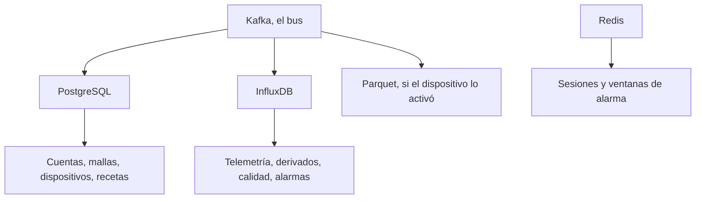

Cuatro almacenes. PostgreSQL es la flota. InfluxDB son las muestras. Parquet es el archivo opcional. Redis es caché, sesiones y ventanas cortas de alarma. Kafka es el bus entre ellos, no un almacén de registro.

Perder Redis tira las sesiones y un lote de alarma en vuelo. Perder Kafka deja parado el pipeline. La flota y las muestras son las dos de las que se puede reconstruir una imagen.

<Callout type="info" title="El rol de lecturas no ve una clave">
Se le conceden el id de la malla, el dueño y si la malla es pública. No se le concede `psk_b64`.
</Callout>

## PostgreSQL

Las claves primarias son UUID salvo que se diga otra cosa. El modelo de usuario es `owners`.

| Tabla | Guarda |
| --- | --- |
| `owners` | Correo, nombre, hash de la clave de API, tokens de verificación y de reseteo, enfriamiento del correo de alarma, rol (`member` u `operator`) |
| `operator_requests` | Una petición pendiente por dueño, y luego la decisión |
| `terms_acceptances` | Prueba, solo de añadir, de qué texto se aceptó, para cuenta, malla, fuente o destino. Quien acepta queda copiado para que la fila sobreviva al borrado |
| `sources` | Bróker remoto, topic, contraseña de solo escritura. `paused_at` cuando caducaron las condiciones |
| `meshes` | Canal, PSK, dueño, marca de pública, fuente opcional, descubrimiento de pasarelas |
| `devices` | Número de nodo, marca de pasarela, marca de permitido, intervalos, identidad, posición, archivo |
| `traceroutes` | Una fila por paquete de traceroute en una malla |
| `rf_links` | Un salto dirigido por origen de observación |
| `sinks`, `mesh_sinks`, `device_sinks` | Qué se publica, y desde qué mallas o dispositivos |
| `sink_instructions` | Registro de encendido y apagado, solo de añadir, para el archivo y para cada destino MQTT |
| `data_deletions` | Las lecturas de una malla, programadas para borrarse tras un periodo de gracia |
| `postprocessing_blueprints`, versiones, pasos | La receta. Los pasos pertenecen a una versión |
| `device_postprocessings`, enlaces de entrada, calibraciones, backfills | La receta aplicada a un dispositivo |
| `telemetry_variants`, `measurement_types` | El catálogo. Un tipo es único en `(payload_kind, field_name)` |
| `device_telemetry_variants`, `measurements` | Lo que este dispositivo ha informado de verdad, y la sustitución de detectores |

`quantity_kind` es `physical_property`, `concentration`, `count`, `ratio` u `other`. Un `vocabulary_uri` opcional apunta a un concepto QUDT o EIONET.

La cardinalidad, en corto: un dueño tiene muchas mallas y muchas plantillas. Una malla tiene muchos dispositivos. Un dispositivo tiene muchos canales y cualquier número de postprocesados. Una plantilla pública la puede asociar quien no la posee; editarla sigue siendo del dueño.

Al rol de lecturas se le conceden `id`, `owner_id` e `is_public` en las mallas, y las columnas de dirección en los dispositivos. No puede seleccionar `psk_b64`.

## InfluxDB

El bucket sale de `INFLUX__BUCKET` (por defecto `telemetry`). Un canal es `measurement.field`. `payload_kind` es siempre `namespace:measurement`, y la mitad measurement es el nombre de measurement de Influx.

| Espacio | Measurement | Origen | Campos típicos |
| --- | --- | --- | --- |
| `telemetry` | Nombre de la variante protobuf (`environment_metrics`, …) | Medido | Hojas numéricas de ese submensaje |
| `device` | `position` | Dispositivo | `latitude`, `longitude`, `altitude` |
| `device` | `nodeinfo` | Dispositivo | `user_id`; etiquetas de nombre largo, nombre corto, hardware, rol |
| `computed` | `derived` | Plantilla | Salidas, etiquetadas con `blueprint_id` |
| `computed` | `quality` | Completitud | Ratio de relleno y métricas de hueco |
| `computed` | `alarms` | Detectores | `message`, `value` opcional |

Etiquetas habituales en los puntos de telemetría: `mesh_id`, `node_id` y, si vienen, `channel_id` y `gateway_id`. Cada punto lleva también `packet_id` y `timestamp_quality` (`rx_time` o `payload`). Los puntos de alarma usan las etiquetas `detector`, `mesh_id`, `node_id`, `channel` opcional y `source` (`stream` o `batch`).

Los mensajes de texto y los paquetes de enrutado no se escriben.

## Parquet

Prefijo de `S3_WRITER__PREFIX` (por defecto `telemetry`). Un objeto por malla y hora UTC. Las columnas incluyen `node_id`, `packet_id`, `portnum`, `rx_time`, `hop_start`, `channel_id`, `gateway_id`, `payload_kind` y `payload_json`. Una partición reescrita se deduplica en `(node_id, packet_id, rx_time, payload_kind)`.

Solo se escriben los dispositivos con `archive_enabled`. Ver [Archivo](/docs/archive).

## Redis

- Caché y sesiones de Django: registro en la base 0, lecturas en la base 1.
- Bróker de Celery para el quality worker en la base 2.
- Ventanas de correo de alarma: un conjunto ordenado de ventanas abiertas y un hash de las alarmas retenidas de cada dispositivo.

Redis no es un modelo de dominio. Perderlo tira las sesiones y los lotes de alarma en vuelo. No tira la flota ni las muestras.
