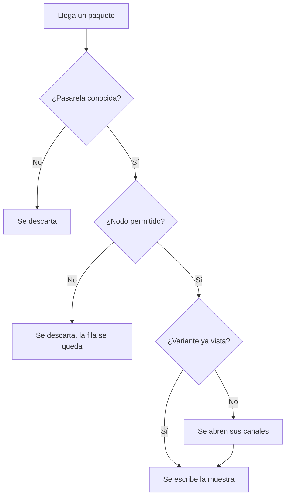

Registra un dispositivo con `POST /devices` desde la página de la malla: el número de nodo de Meshtastic, si es pasarela y una etiqueta opcional. El descifrado también crea o actualiza dispositivos a partir de paquetes que ya puede descifrar, y el descubrimiento de pasarelas puede registrarlas cuando la malla lo permite.

El descifrado hace dos preguntas antes de que un paquete sea una fila. Si falla cualquiera, la muestra no aterriza.

<Callout type="info" title="Rechazar no es borrar">
`is_allowed = false` publica el nodo para que todos los descifradores lo tiren. La fila se queda, así que puedes permitirlo otra vez. Los lectores de una malla pública no ven los dispositivos rechazados.
</Callout>

El inventario en `/console/devices` lista todos los dispositivos que puedes ver. Filtra por malla, pasarela, permitido y si tiene una plantilla asociada. Abre una fila para la ficha.

## Pasarela o nodo

`is_gateway` marca a quien publica en MQTT. Su número de nodo es como el descifrado encuentra la PSK, así que dos pasarelas permitidas no pueden compartir número en toda la instancia. Los nodos normales solo tienen que ser únicos dentro de su malla.

Se pueden guardar hasta tres claves de administración de Meshtastic (`admin_keys_b64`). Solo las ve el dueño de la malla. Coinciden con el límite del firmware de tres entradas `admin_key`.

## Permitido y rechazado

`is_allowed = false` publica el nodo en `mesh.node_rejections.v1`. El descifrado tira esos paquetes. El dispositivo sigue en el registro para poder permitirlo otra vez. Los lectores de una malla pública no ven las filas rechazadas.

## Nombre, rol y lugar

NodeInfo rellena `name`, `short_name`, `hardware_type` y `role` hasta que pones `nodeinfo_overridden`. La posición rellena latitud y longitud hasta que pones `location_overridden`. Con la marca puesta, los paquetes posteriores no pisan lo que escribiste.

`last_seen` es la última vez que el descifrado oyó el dispositivo. `discovered_at` se pone cuando el descubrimiento de pasarelas creó la fila, y no tú.

## Intervalos

`reading_interval_seconds` es cada cuánto se espera que el sensor muestree. Lo usan los detectores y la alineación de las plantillas. `publish_interval_seconds` es cada cuánto se espera que la radio envíe. El detector de ausencia compara el silencio con ese intervalo.

Déjalos vacíos si aún no lo sabes. La variante del catálogo puede traer un intervalo de lectura por defecto hasta que el dispositivo tenga el suyo.

## Canales de este dispositivo

La ficha lista las variantes de telemetría (`GET /devices/{id}/telemetry-variants`) y los canales vivos (`GET /devices/{id}/measurements`). Un canal aparece cuando esa variante se ve por primera vez. No creas `environment_metrics.temperature` a mano.

En cada canal:

- `enabled_detectors = null` hereda el valor por defecto del catálogo.
- `enabled_detectors = []` silencia los detectores de ese canal.
- `valid_min` y `valid_max` se ponen juntos para el detector de rango. Los dos vacíos significa que el rango no se comprueba.

La ausencia no es un interruptor por canal. Es `absence_detection_enabled` en el dispositivo. Ver [Calidad y alarmas](/docs/quality).

## Archivo

`archive_enabled` incluye este dispositivo en el archivo Parquet. La API lo acepta solo en una malla cuyo dueño es operador, y solo cuando la instancia tiene archivo. Apagarlo deja de escribir objetos nuevos y conserva lo ya escrito. La consola llama a este interruptor **S3 storage**. Ver [Archivo](/docs/archive).
