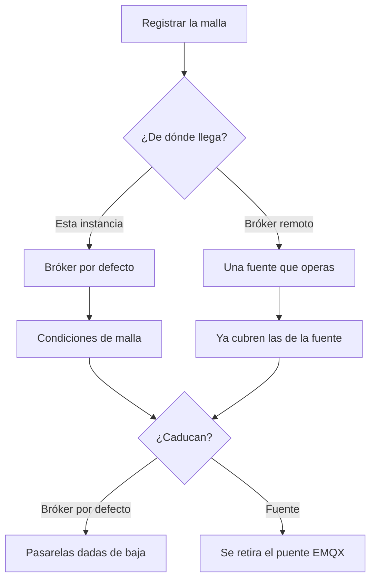

Una malla se registra con `POST /meshes`: un id de canal, una PSK y una etiqueta opcional. La clave se publica en el topic compacto de Kafka `mesh.keys.v1`, con clave el id de pasarela, para que el descifrado no pregunte a la API en cada paquete.

De dónde vienen los paquetes decide qué condiciones se aplican, y qué pasa cuando caducan.

<Callout type="warn" title="Pública es solo lectura">
`is_public` deja que otras personas, y las llamadas anónimas a la API, lean dispositivos e histórico. No les deja editar la malla, ver la PSK ni ver un nodo que rechazaste.
</Callout>

La consola lista tus mallas en `/console/meshes`. Abre una para ver juntas sus pasarelas y sus nodos.

## Quién puede leer y escribir

| Acción | Quién |
| --- | --- |
| Leer dispositivos y lecturas | El dueño, un superusuario, y cualquiera si `is_public` está activo. Las llamadas anónimas a la API solo ven mallas públicas. |
| Ver la PSK | El dueño y un superusuario. Staff no la ve. Un lector de una malla pública tampoco. |
| Ver nodos rechazados | El dueño y un superusuario. |
| Editar, borrar, registrar dispositivos | El dueño y un superusuario. |

## De dónde llega el tráfico

`source` es null cuando los paquetes llegan por el topic del bróker de esta instancia. Un operador puede apuntar la malla a una de sus [fuentes](/docs/sources). Sacar una malla de su fuente, o borrarla, programa el borrado de sus lecturas guardadas tras un periodo de gracia. Los superusuarios vigilan esos trabajos en **Gestión → Borrados programados**.

En el bróker por defecto, las condiciones de malla se aplican al dueño como responsable de ese tráfico. En una fuente se aplican las condiciones de la fuente y el formulario de malla no vuelve a pedirlas. Si caducan:

- Bróker por defecto: la malla se pausa y sus pasarelas se dan de baja hasta que el dueño renueve.
- Fuente: se retira el puente EMQX de esa fuente hasta que el operador renueve.

La columna de estado de la consola ordena primero lo urgente: borrado programado, fuente en pausa, fuente desconectada, condiciones cambiadas, renovar pronto, condiciones aún no aceptadas, estado de fuente desconocido y, al final, activa. Una instancia lite que no exige condiciones muestra las mallas como activas salvo que el propio puente esté mal.

## Descubrir pasarelas

`discover_gateways` deja que la plataforma registre pasarelas cuyos paquetes se descifran con el canal y la PSK de esta malla, sin que el dueño añada cada una. El descubrimiento va dosificado (unas 50 pasarelas por minuto) para que un bróker ocupado no inunde el registro. Los nodos bajo una pasarela descubierta se siguen creando a partir de los avistamientos del descifrado.

Una fila creada así tiene `discovered_at`. Sigues pudiendo rechazarla.

## Mallas públicas

Activa `is_public` cuando los lectores deban ver la flota y el histórico. No pueden cambiarla, no ven la PSK y no ven los dispositivos que hayas rechazado.

## Borrar una malla

Borrar una malla no borra las lecturas en la misma petición. Se programa un trabajo de borrado, con motivo `mesh_deleted`, que corre después de `delete_after`. Lo mismo ocurre cuando una malla deja su fuente (`source_detached`) o cuando caducan las condiciones de la fuente (`terms_lapsed`). Renovar las condiciones, o devolver la malla a esa fuente, puede cancelar un trabajo pendiente.
