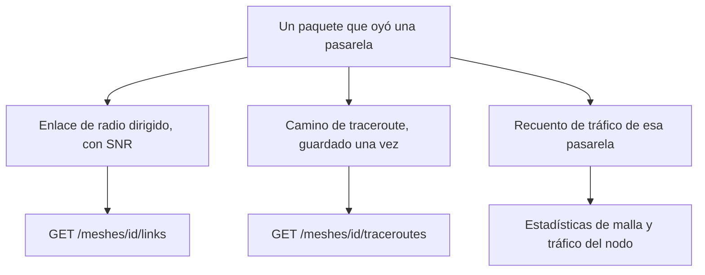

El descifrado hace más que guardar valores de sensor. También guarda una imagen de la red de radio: qué nodos oyeron a cuáles, el camino que tomó un traceroute y cuánto tráfico lleva cada pasarela.

Un paquete puede alimentar tres imágenes. Responden a preguntas distintas, así que no se sustituyen.

<Callout type="info" title="Ocupado no es medido">
El tráfico cuenta paquetes. Un nodo puede ser ruidoso en la malla y no tener canal de temperatura.
</Callout>

## Enlaces de radio

`GET /meshes/{id}/links` devuelve un salto dirigido: `from_node` transmitió, `to_node` midió la SNR. Un enlace se cuenta aparte por cada forma en que se observó:

| Origen | Significado |
| --- | --- |
| `traceroute` | Un salto nombrado en un traceroute |
| `neighborinfo` | Un informe de vecinos |
| `direct` | Un paquete oído directamente del emisor |

Cada fila guarda el número de muestras, la suma de SNR, la última SNR y la primera y última vez que se vio. La SNR está en dB, y es null donde el paquete no la midió. Los valores de SNR de un traceroute más allá del camino conocido se ignoran, en lugar de dar el paquete por fallido.

## Traceroutes

`GET /meshes/{id}/traceroutes` devuelve los paquetes de camino. Un traceroute se guarda una vez, oiganlo las pasarelas que lo oigan. `from_node` envió el paquete y `to_node` era el destino. En una respuesta (`request_id` puesto) ese par es el inverso de la dirección propia del traceroute. `route` y `route_back` son números de nodo; `snr_towards` y `snr_back` se alinean con ellos. `gateway_ids` lista quién oyó esta copia.

## Tráfico

Se cuenta cada paquete que oye una pasarela registrada.

- `GET /readings/meshes/{id}/stats` es la malla: solapamiento de pasarelas, retransmisiones, actividad.
- `GET /readings/devices/{uuid}/traffic` y el gemelo por número de nodo son los tipos de paquete y el volumen de un nodo.

Estos números describen la radio, no el catálogo de sensores. Un nodo puede estar ocupado en la malla y no tener canal de temperatura.
