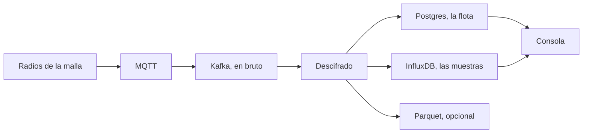

Mesh Things convierte una malla LoRa de [Meshtastic](https://meshtastic.org/) en una flota gestionada. Las pasarelas publican paquetes protobuf en MQTT. Esta plataforma los descifra con la clave de la malla, guarda las lecturas y deja que el dueño las consulte y configure por HTTP y en la consola.

Un paquete no cae en una sola caja. Cada etapa guarda una promesa distinta: el bus recuerda el sobre, Postgres recuerda la flota, InfluxDB recuerda las muestras.

<Callout type="warn" title="Un solo descifrador">
`lite` y `full` leen el mismo topic en bruto. Elige uno. Arrancar los dos hace que dos consumidores compitan por los mismos paquetes.
</Callout>

## Para quién es

- Dueños que operan una o varias mallas y quieren un registro duradero de los sensores.
- Quien necesita saber cuándo un nodo se calla, un sensor se queda fijo o un valor sale del rango válido.
- Equipos que calculan canales extra a partir de lecturas en bruto, con una calibración que puede cambiar con el tiempo.
- Operadores que traen un bróker MQTT remoto, o entregan un subconjunto de lecturas a un tercero.
- Lectores que deben ver una malla pública y no cambiar nada.

## Qué le pasa a un paquete

1. **Entrada.** Un puente MQTT copia el tráfico a Kafka como sobre en bruto. El bróker puede ser el de esta instancia o uno remoto dado de alta como [fuente](/docs/sources).
2. **Descifrado.** Un consumidor en Python (`lite`) o un trabajo de Flink (`full`) descifra con la clave precompartida de la malla y emite JSON estructurado. Las pasarelas desconocidas y los nodos rechazados se descartan.
3. **Catálogo.** Los avistamientos y el descubrimiento de sensores crean o actualizan dispositivos, variantes de telemetría y canales de medida en PostgreSQL.
4. **Almacén.** Los eventos descifrados van a InfluxDB. En un despliegue completo, los dispositivos que lo activan también se archivan como Parquet por horas.
5. **Proceso.** El perfil completo aplica detectores en flujo. Un worker por lotes ejecuta plantillas y comprobaciones de completitud sobre el histórico.
6. **Servicio.** Caddy reparte la API de registro (cuentas, mallas, dispositivos, catálogo) y la API de lecturas (series, últimos valores, exportaciones, archivo). La consola es la interfaz sobre las dos.

## Dos tamaños de despliegue

| Modo | Equipo típico | Qué incluye |
| --- | --- | --- |
| `lite` | Una placa de un solo ordenador | Entrada MQTT, descifrado en Python, InfluxDB, las dos APIs |
| `lite` + `quality` | Lo mismo, con más CPU | Plantillas por lotes y análisis de completitud |
| `full` | Una máquina mayor | Flujos de Flink, destinos y el worker por lotes. Añade `minio` para guardar el archivo Parquet en el almacén incluido |

`lite` y `full` son alternativas para el descifrado. Arrancar los dos a la vez los hace competir por el mismo topic en bruto.

## Dónde vive cada dato

| Asunto | Almacén |
| --- | --- |
| Cuentas, mallas, claves, dispositivos, catálogo, plantillas | PostgreSQL |
| Telemetría, posiciones, información de nodo, canales derivados, calidad, alarmas | InfluxDB |
| Archivo de eventos descifrados, si el dispositivo lo activa | S3 o MinIO, en Parquet |
| Sesiones, límites de tasa, ventanas de correo de alarma | Redis |
| Eventos en vuelo y la configuración actual de descifrado | Kafka |

El contrato HTTP en vivo es el OpenAPI del registro en `/schema`, con Swagger UI en el host de la API. Ese documento es distinto de esta guía de la consola.

## Sigue por aquí

<Cards>
  <Card title="Conceptos" href="/docs/concepts" description="Malla, pasarela, nodo y los dos sentidos de canal." />
  <Card title="Cuentas" href="/docs/accounts" description="Alta, la cookie de sesión y quién puede ver una PSK." />
  <Card title="Arquitectura" href="/docs/architecture" description="Perfiles, servicios y los topics de Kafka que los unen." />
  <Card title="Almacenes de datos" href="/docs/data" description="Qué guardan Postgres, InfluxDB, Parquet y Redis." />
</Cards>
