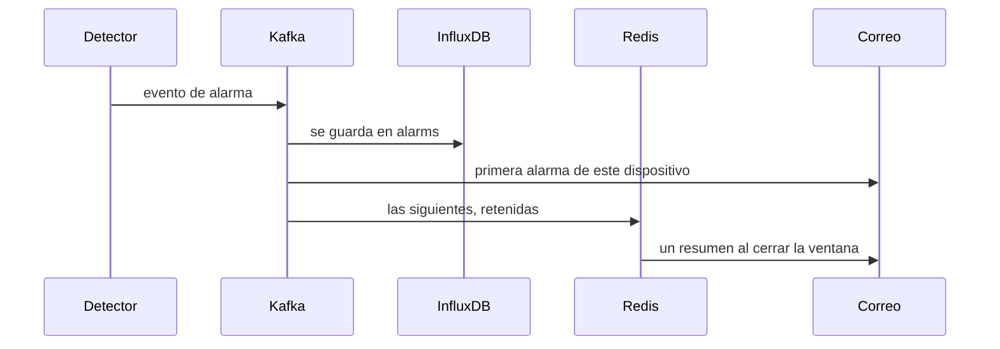

Los detectores los lista `GET /detectors`. Un canal ejecuta los de `enabled_detectors`, o el valor por defecto del catálogo cuando ese campo es null. Una lista vacía silencia el canal. La ausencia es la excepción: es un interruptor del dispositivo, porque el silencio es de la radio, no de un campo.

Una alarma no es un correo. Primero se escribe el evento. El correo es una decisión posterior, y se agrupa.

<Callout type="warn" title="Tres detectores piden full">
`flat_value`, `range` y `absence` corren en Flink. Una caja lite no los ejecuta. Completitud y plantillas sí pueden correr si añades el perfil `quality`.
</Callout>

| Detector | Ámbito | Dónde corre | Qué necesita |
| --- | --- | --- | --- |
| `flat_value` | Canal | Trabajo de patrones de Flink, perfil completo | Un intervalo de lectura. La ventana es unas tres horas de muestras. |
| `range` | Canal | Trabajo de patrones de Flink, perfil completo | `valid_min` y `valid_max` en ese canal, puestos juntos. |
| `absence` | Dispositivo | Trabajo de ausencia de Flink, perfil completo | `absence_detection_enabled` y `publish_interval_seconds`. |
| `completeness` | Canal | Quality worker, por lotes | `reading_interval_seconds`. Alarma si el ratio de relleno es bajo o hay un hueco largo. |

`lite` no ejecuta los trabajos de Flink. Añade el perfil `quality` si aún quieres completitud y plantillas en una máquina pequeña. `flat_value`, `range` y `absence` pertenecen a `full`.

Los eventos de alarma son JSON en `mesh.telemetry.alarms.v1`. El escritor de Influx también los guarda en el measurement `alarms`, etiquetados con el detector, la malla, el nodo, un canal opcional y `source` (`stream` o `batch`).

## Correo

La primera alarma de un dispositivo envía correo al dueño de la malla al momento. Las siguientes de ese mismo dispositivo, sea cual sea el detector o el canal, se retienen en Redis durante `alarm_email_cooldown_seconds`. Cuando se cierra la ventana, un correo resumen lista lo retenido. Un enfriamiento de 0 envía cada alarma.

El dueño puede sustituir el valor del servidor desde su perfil. El correo usa el estilo HTML de la consola y enlaza de vuelta (`REGISTRY__PUBLIC_FRONTEND_URL`). Los dueños también reciben un recordatorio diario mientras las alarmas siguen abiertas.

`GET /status/email` deja que el monitor compruebe que el envío funciona. Es un extremo de operaciones, no una página de la consola.

## Qué enseña la consola

**Automation → Alarms** es donde eliges qué vigilar en cada medida. La ficha del dispositivo es donde un canal hereda, sustituye o silencia esa elección, y donde se enciende la ausencia para todo el dispositivo.
