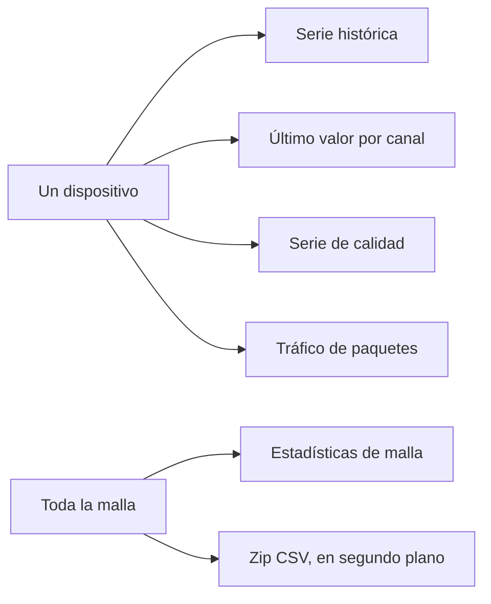

Las lecturas viven en InfluxDB. La API de lecturas no devuelve nunca la PSK de la malla. Puedes consultar por el id de registro del dispositivo, o por el id de malla más el número de nodo de Meshtastic.

El mismo almacén, cuatro preguntas. Elige el camino que corresponde a la pregunta, no a la pantalla en la que estés.

<Callout type="info" title="Una descarga a la vez">
Una segunda exportación mientras otra se prepara vuelve como 429. El enlace vive 24 horas. Después el fichero desaparece y hay que pedirlo otra vez.
</Callout>

| Pregunta | Ruta |
| --- | --- |
| Muestras históricas | `GET /readings/devices/{uuid}` o `GET /readings/meshes/{mesh}/nodes/{node}` |
| Último valor por canal | `.../latest` |
| Serie de calidad | `.../quality` |
| Tráfico de paquetes de un nodo | `.../traffic` |
| Tráfico de toda la malla | `GET /readings/meshes/{mesh}/stats` |

Consulta una serie con `channel`, `start`, `stop`, `window` y `agg`. La ficha del dispositivo usa por defecto las últimas 24 horas, una ventana de una hora y la media, y prefiere `environment_metrics.temperature` cuando ese canal existe.

`start` y `stop` aceptan una hora o un valor relativo como `-24h`. `window` es el tamaño del cubo. `agg` es el reductor dentro del cubo (`mean` y los demás que lista la API).

Los últimos valores son las tarjetas de arriba de la ficha: valor, unidad, tipo de magnitud y hora. Un lookback vacío es un estado vacío, no un cero.

## Descargas CSV

Cualquier dueño de malla puede llevarse las lecturas en CSV. Los superusuarios también. La ficha tiene **Download CSV** para ese dispositivo. `/console/csv-downloads` (en **Data**) puede cubrir una malla entera o un subconjunto.

Una descarga es un zip, preparado en segundo plano.

| Límite | Valor |
| --- | --- |
| Rango más largo | 366 días |
| En preparación a la vez | Una. Una segunda petición es 429. |
| Vida del enlace | 24 horas. Llega un correo cuando está lista. |
| Listada para volver a pedirla | 30 días |

Los estados son `queued`, `running` (días hechos de días totales), `ready` (una URL firmada hasta `expires_at`), `failed` (un texto de error) y `expired` (el fichero ya no está; pídelo otra vez).

Las exportaciones Parquet del archivo usan la misma maquinaria de trabajos con `format: parquet`. Ver [Archivo](/docs/archive).

## Límites de tasa

Las lecturas se limitan por dueño. Los superusuarios no tienen límite.
