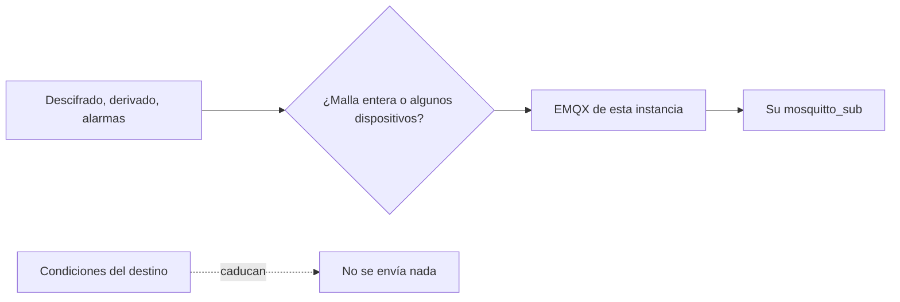

Un destino es lo contrario de una fuente. Un operador publica lecturas en el bróker EMQX de esta instancia, y un consumidor que él elige se suscribe con su propio usuario y contraseña. La contraseña vive hasheada en EMQX. La API la muestra una vez, al crearla o al rotarla.

Eliges el flujo y las radios. El consumidor no ve nunca la clave de la malla.

<Callout type="warn" title="La contraseña se muestra una vez">
Emitir una contraseña nueva desconecta a quien esté conectado ahora. Borrar el destino revoca las credenciales. No puedes borrar un destino que aún tiene mallas o dispositivos asociados.
</Callout>

Los destinos necesitan EMQX. En un despliegue sin él, todas las rutas de destino responden 404 y la consola lo dice. El perfil `sinks` los enciende en un stack lite; `full` los incluye.

Solo operadores y superusuarios gestionan destinos, y un operador ve solo los que creó. La página es `/console/sinks`, junto a Sources y Archive.

## Qué se envía

`streams` es un subconjunto no vacío de `decoded`, `derived` y `alarms`, guardado en ese orden.

**Send from** es o bien:

- una malla entera, incluidos los nodos que aparezcan después, o
- dispositivos sueltos

Marcar la malla desactiva las casillas de dispositivo ("included with the mesh"). Desmarcarla restaura las elecciones sueltas que tuvieras, y esas elecciones son las que se guardan. Al editar, cada lista que envías sustituye la actual. Las credenciales no cambian al editar.

La malla o el dispositivo tiene que ser uno que puedas editar, y el dueño de la malla tiene que ser operador. Un superusuario puede asociar destinos en las mallas de un operador.

## Credenciales

El alta, y **Issue a new password**, devuelven la contraseña una vez: bróker, usuario, contraseña y filtro de tema, más una línea `mosquitto_sub` con sesión persistente. Emitir una contraseña nueva desconecta a los consumidores actuales. Borrar el destino revoca las credenciales.

No puedes borrar un destino que aún tiene mallas o dispositivos asociados. La API responde 409; edítalo y quítalos antes.

## Condiciones

Cada alta acepta las condiciones vigentes de destino. El operador responde de lo que el destino envía y de a quién entrega las credenciales. Si la aceptación caduca, se pone `paused_at`: no se envía nada, y el consumidor es rechazado, hasta que quien lo creó renueva.

La lista muestra si está enviando o en pausa, de cuántas mallas y dispositivos sale, y cuántos consumidores hay conectados ahora. Las conexiones salen como una raya cuando el bróker no responde.
