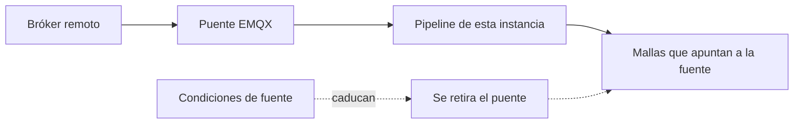

Una fuente es un bróker MQTT remoto y un filtro de topic. El EMQX de esta instancia se suscribe y copia el tráfico coincidente al pipeline. Solo operadores y superusuarios gestionan fuentes. Un operador ve las que creó. Un superusuario las ve todas. El resto recibe 403, y el menú **Data** oculta la página. Abrir `/console/sources` directamente les devuelve a las mallas.

Una fuente tira. No se guarda nada hasta que el puente está de verdad en pie, y el puente vuelve a caer cuando caducan las condiciones.

<Callout type="warn" title="Un puente fallido no guarda nada">
Si EMQX no puede crear el puente, la API responde 502 y la fuente no se guarda. Al editar, un 502 significa que la fuente almacenada no cambió.
</Callout>

Un miembro pide el rol de operador desde su perfil. Ver [Cuentas](/docs/accounts).

## Qué se registra

| Campo | Regla |
| --- | --- |
| Etiqueta | Nombre opcional en la lista |
| Servidor | `host:port` |
| Topic | El filtro a puentear. `$share` y `$SYS` se rechazan. |
| TLS | Activo por defecto |
| Usuario y contraseña | La contraseña es de solo escritura. No se devuelve nunca. |
| QoS | 0 o 1. Por defecto 1. |

Crear una fuente acepta las condiciones vigentes de fuente (`GET /sources/terms`) y envía `terms_version`. El operador es el responsable del tráfico puenteado; Sensical es el encargado. La aceptación es un contrato con el operador, guardada con el hash del texto exacto, y se pide en cada alta, no al editar. Una instancia lite que no exige condiciones se salta el paso.

Si EMQX no puede crear el puente, la API responde 502 y no guarda nada.

## Mallas en una fuente

Al crear o editar una malla, un operador elige **Default broker** o una de sus fuentes. `source_id: null` es el bróker por defecto. La lista muestra el nombre de la fuente en las mallas que posees. La malla de otro no enseña el id de fuente.

No puedes borrar una fuente que aún tiene mallas. El diálogo las lista y enlaza cada una. Sácalas antes.

## Pausa, renovación, desconexión

Las condiciones de fuente pueden caducar. Cuando caducan, se pone `paused_at`, se retira el puente y las mallas de esa fuente dejan de entrar hasta que quien la creó renueva (`POST /sources/{id}/terms-acceptance`). La lista muestra el estado y una acción Renew para quien la creó cuando la fuente está en pausa, caduca pronto o está atada a un texto que cambió.

Editar la contraseña: déjala igual, envía un valor nuevo o envía una cadena vacía para quitarla. Un 502 al editar significa que el puente no se reconfiguró y la fuente guardada no cambió.

Las fuentes ocupadas pueden avisar por correo al operador que las creó, y a los superusuarios, cuando se mantienen por encima de la tasa que la instancia permite.
