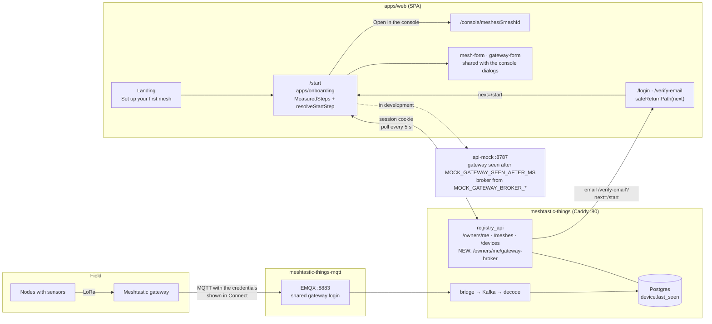
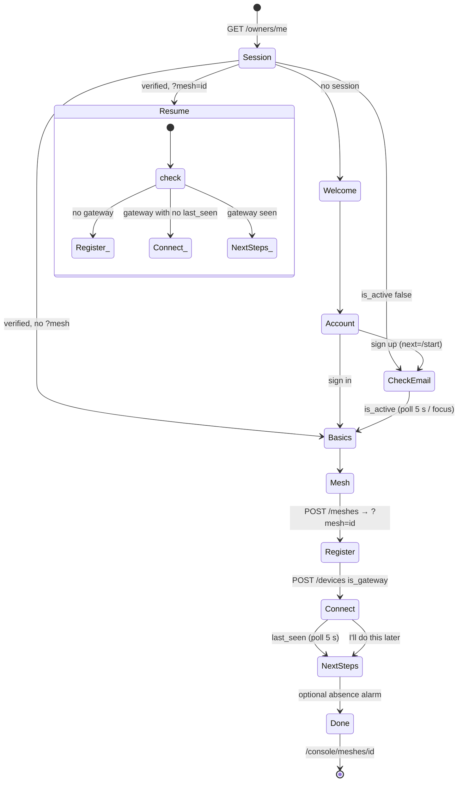
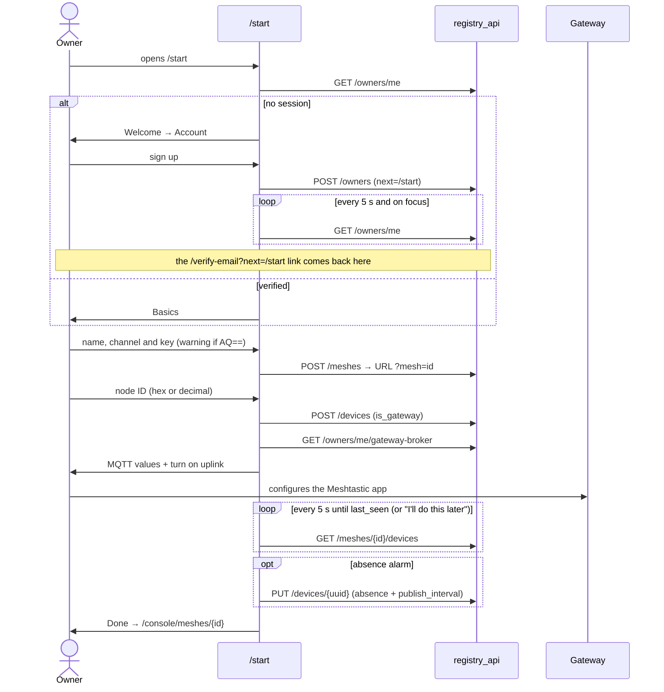

# `/start` onboarding: diagrams

Proposal for issue #61. The detail is in the OpenSpec change `openspec/changes/add-start-onboarding/`. Implemented in `apps/onboarding` (`/start`); the open verification items are in that change's `tasks.md`.

## Pieces

## Steps and resume

## Sequence

